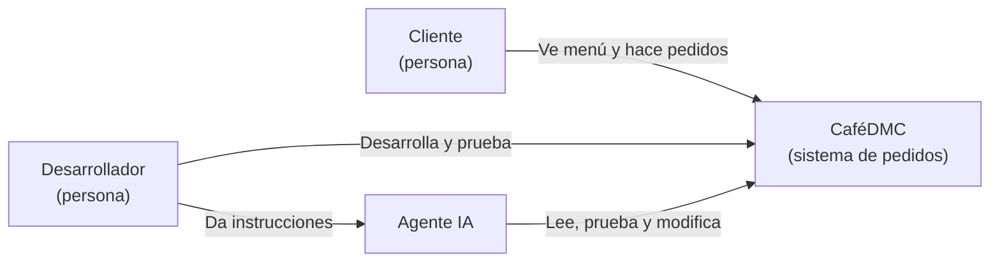
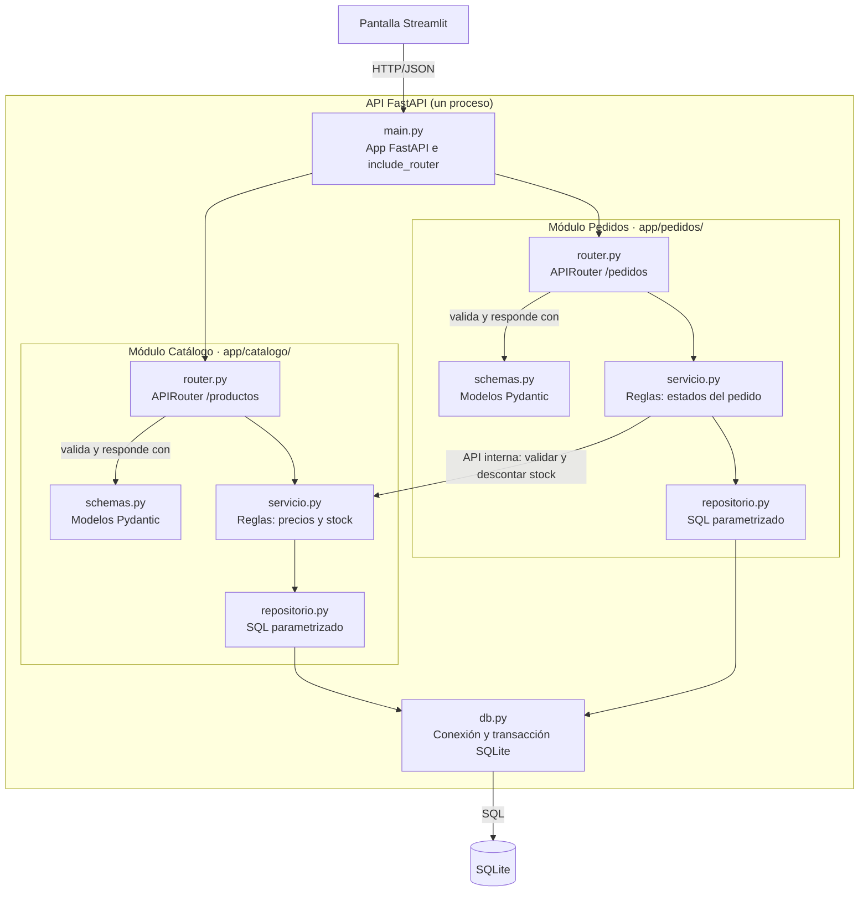

# Arquitectura de CaféDMC

Stack: ver [ADR-0001](adr/0001-stack.md).

## 1. Contexto (C4 nivel 1)

## 2. Contenedores (C4 nivel 2)

```mermaid
flowchart LR
    cliente["Cliente"]
    agente["Agente IA"]

    subgraph cafedmc["CaféDMC"]
        ui["Pantalla<br/>(Streamlit)"]
        subgraph api["API (FastAPI)"]
            catalogo["Catálogo"]
            pedidos["Pedidos"]
        end
        db[("SQLite")]
    end

    mcp["Servidores MCP"]

    cliente -->|"Usa"| ui
    ui -->|"HTTP/JSON"| catalogo
    ui -->|"HTTP/JSON"| pedidos
    catalogo -->|"SQL"| db
    pedidos -->|"SQL"| db
    agente -->|"Consulta"| mcp
    mcp -.->|"Solo lectura"| db
    agente -->|"Escrituras HTTP"| api
```

El agente lee la base solo a través de MCP; todo cambio de datos pasa por la API.

## 3. Componentes de la API (C4 nivel 3)

> **Diseño objetivo.** `app/` todavía no tiene código; este diagrama describe la estructura
> acordada en [ADR-0002](adr/0002-estilo-arquitectura.md) (monolito modular). Cuando exista el
> código, el diagrama debe reflejar lo que hay en él.

| Componente | Responsabilidad |
|---|---|
| `main.py` | Crea la app FastAPI y registra el router de cada módulo. |
| `router.py` | Endpoints HTTP del módulo. Recibe y devuelve modelos Pydantic; delega en el servicio. |
| `schemas.py` | Modelos Pydantic de entrada y salida (lo que ve el cliente HTTP). |
| `servicio.py` | Reglas de negocio del módulo. Es la única puerta de entrada para otros módulos. |
| `repositorio.py` | Acceso a datos con SQL parametrizado, solo sobre las tablas del módulo. |
| `db.py` | Abre la conexión a SQLite y maneja la transacción, compartida por los repositorios. |

Reglas de conexión (ver ADR-0002):
- Un router solo habla con el servicio de su módulo; nunca con un repositorio.
- Pedidos usa Catálogo solo a través de `catalogo/servicio.py`; nunca importa su repositorio ni lee sus tablas.
- Crear, pagar o anular un pedido y su efecto en el stock ocurren en la misma transacción de `db.py`.
