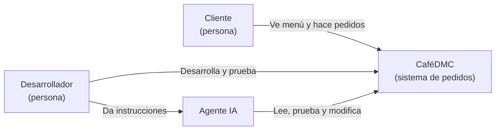
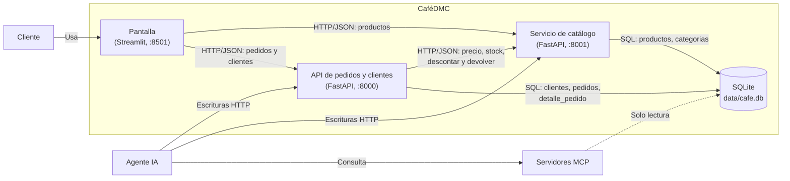
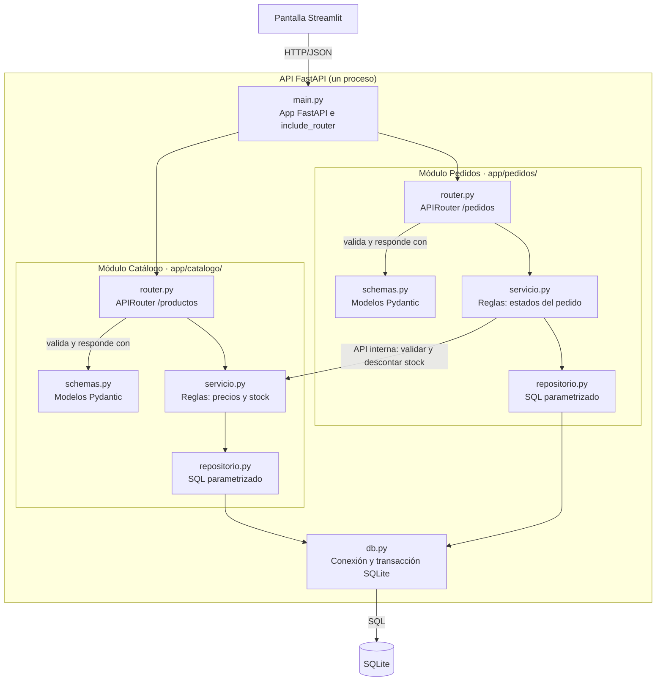
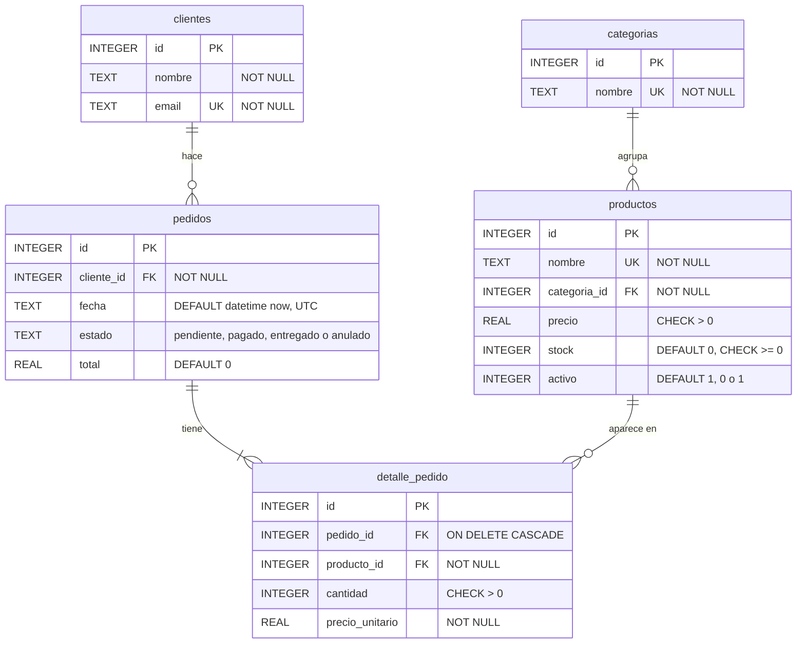

# Arquitectura de CaféDMC

Stack: ver [ADR-0001](adr/0001-stack.md).

## 1. Contexto (C4 nivel 1)

## 2. Contenedores (C4 nivel 2)

Desde [ADR-0003](adr/0003-separar-catalogo-como-servicio.md), el catálogo corre como servicio
propio.

- El agente lee la base solo a través de MCP; todo cambio de datos pasa por los servicios.
- Los dos servicios comparten la misma SQLite, pero cada uno hace SQL solo sobre sus tablas.
  Pedidos no tiene transacción común con el stock: si un descuento falla, devuelve lo ya
  descontado (compensación, ver ADR-0003).

## 3. Componentes de la API (C4 nivel 3)

> **Diseño objetivo, todavía no implementado.** Este diagrama describe la estructura acordada en
> [ADR-0002](adr/0002-estilo-arquitectura.md). El código actual es más simple: un archivo por
> módulo (`app/catalogo.py`, `app/pedidos.py`, `app/clientes.py`) con las reglas en el router.
> Además, desde [ADR-0003](adr/0003-separar-catalogo-como-servicio.md) el catálogo es otro
> proceso: la flecha "API interna" de Pedidos a Catálogo hoy es una llamada HTTP
> (`app/catalogo_cliente.py`), y el pedido y el stock ya no comparten transacción.

| Componente | Responsabilidad |
|---|---|
| `main.py` | Crea la app FastAPI y registra el router de cada módulo. |
| `router.py` | Endpoints HTTP del módulo. Recibe y devuelve modelos Pydantic; delega en el servicio. |
| `schemas.py` | Modelos Pydantic de entrada y salida (lo que ve el cliente HTTP). |
| `servicio.py` | Reglas de negocio del módulo. Es la única puerta de entrada para otros módulos. |
| `repositorio.py` | Acceso a datos con SQL parametrizado, solo sobre las tablas del módulo. |
| `db.py` | Abre la conexión a SQLite y maneja la transacción, compartida por los repositorios. |

Reglas de conexión (ver ADR-0002):
- Un router solo habla con el servicio de su módulo; nunca con un repositorio.
- Pedidos usa Catálogo solo a través de `catalogo/servicio.py`; nunca importa su repositorio ni lee sus tablas.
- Crear, pagar o anular un pedido y su efecto en el stock ocurren en la misma transacción de `db.py`.

## 4. Modelo de datos (diagrama ER)

Tablas de `db/schema.sql`. Cada contexto es dueño de sus tablas: solo su código hace SQL sobre
ellas (AGENTS.md §4).

| Tabla | Dueño | Índices además de la clave primaria |
|---|---|---|
| `categorias` | Catálogo (servicio :8001) | `nombre` (UNIQUE) |
| `productos` | Catálogo (servicio :8001) | `nombre` (UNIQUE), `idx_productos_categoria (categoria_id)` |
| `clientes` | Pedidos y clientes (:8000)\* | `email` (UNIQUE) |
| `pedidos` | Pedidos y clientes (:8000) | `idx_pedidos_cliente (cliente_id)`, `idx_pedidos_estado (estado)` |
| `detalle_pedido` | Pedidos y clientes (:8000) | `idx_detalle_pedido (pedido_id)` |

Notas:
- `detalle_pedido.producto_id` es la única clave foránea que cruza de un contexto a otro. Hoy
  funciona porque los dos servicios comparten la base; si el catálogo pasa a una base propia
  (paso 3 de ADR-0002), habrá que quitarla.
- `precio_unitario` guarda el precio del producto al momento del pedido, así un cambio de precio
  posterior no altera los pedidos ya hechos.
- \* `clientes` la consultan `app/clientes.py` y `app/pedidos.py`; falta dejar un solo dueño
  (ver la bitácora).
