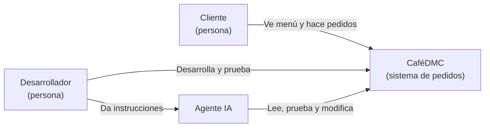
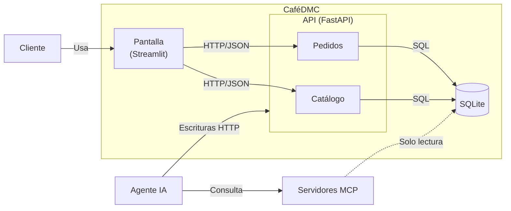

# Arquitectura de CaféDMC

Stack: ver [ADR-0001](adr/0001-stack.md).

## 1. Contexto (C4 nivel 1)

## 2. Contenedores (C4 nivel 2)

El agente lee la base solo a través de MCP; todo cambio de datos pasa por la API.
