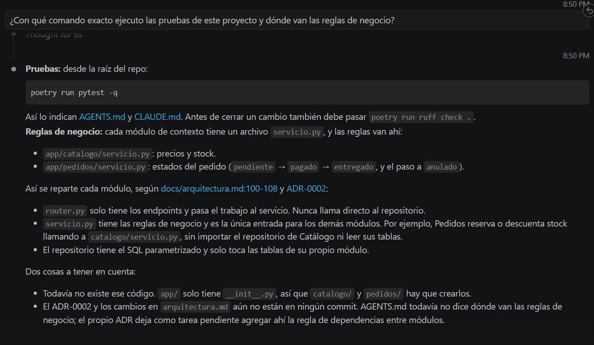
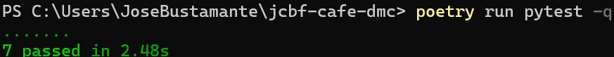
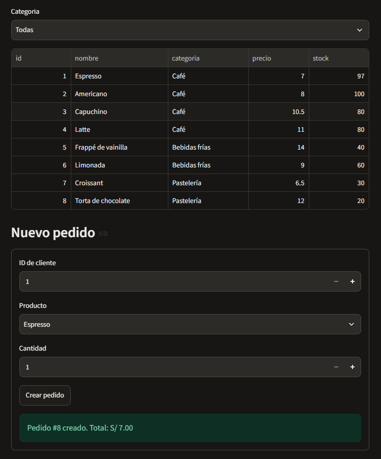
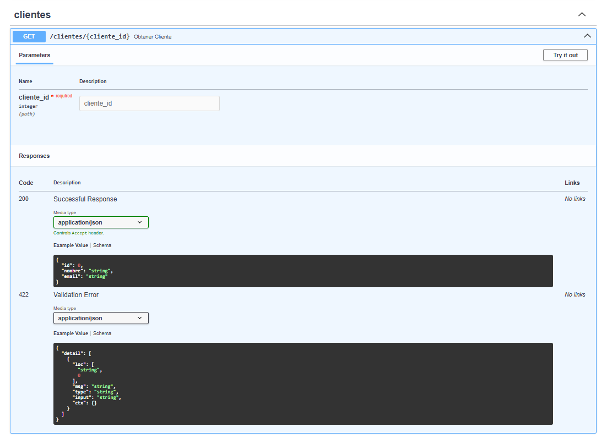
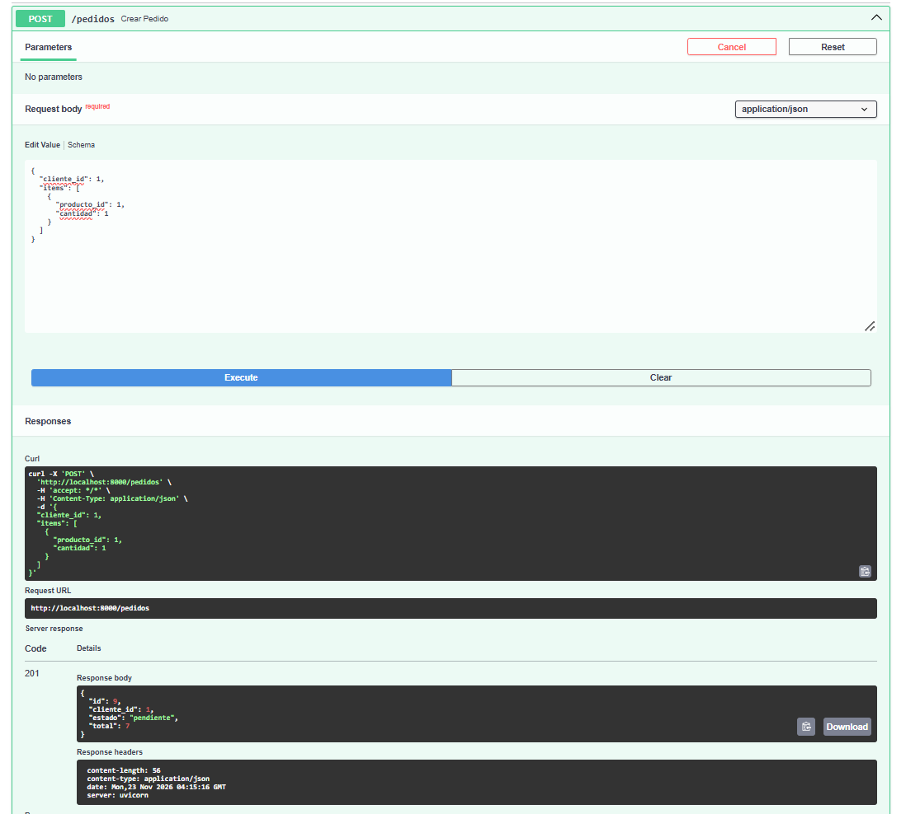
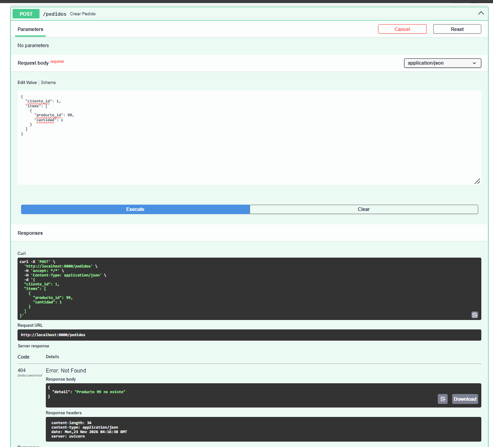
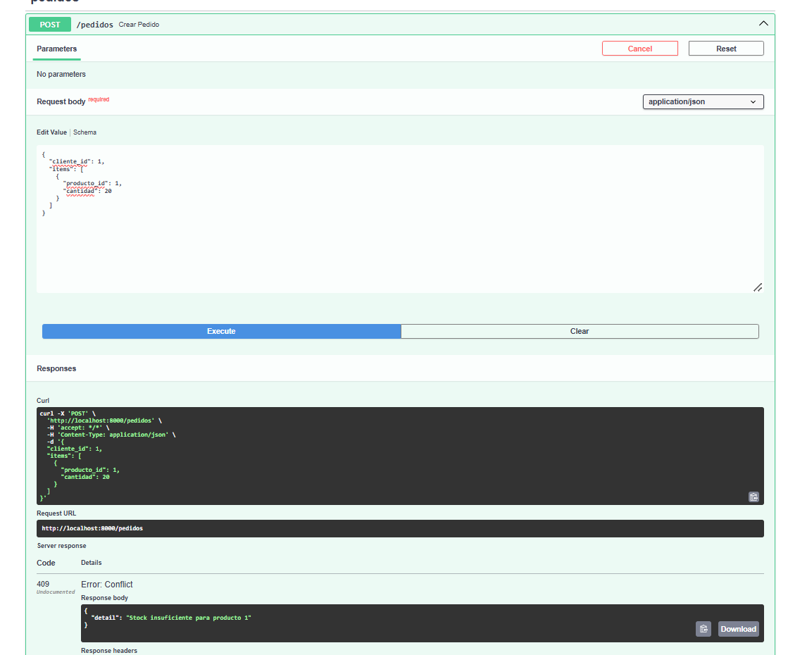
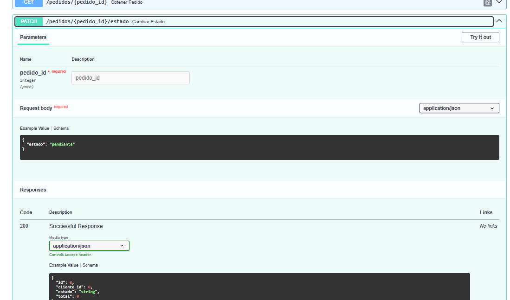
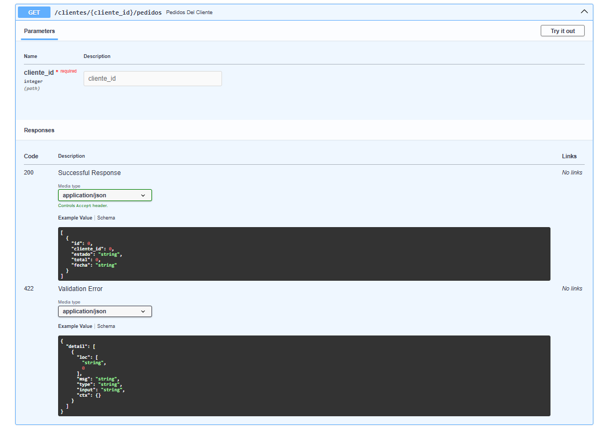
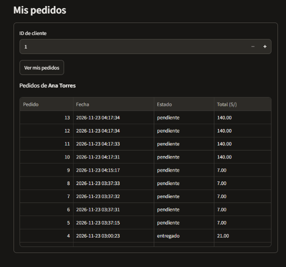

# Bitácora de evidencias · Jose Bustamante

## Sesión 1 · 2026-11-16 (completada el 2026-11-22)

### Evidencias del taller
> Capturas tomadas el 2026-11-22 y guardadas en `docs/img/`. Junto a cada una va la salida
> en texto del comando.

**Versión de Python y ruta del entorno**

```text
> poetry --version
Poetry (version 2.5.1)
> poetry run python --version
Python 3.15.2
> poetry env info --path
C:\Users\JoseBustamante\jcbf-cafe-dmc\.venv
```

**El agente responde el comando de pruebas**

Pregunta (2026-11-22): "¿Con qué comando exacto ejecuto las pruebas de este proyecto y dónde van
las reglas de negocio?". El agente respondió `poetry run pytest -q` citando `AGENTS.md` y
`CLAUDE.md`. Ubicó las reglas de negocio en `servicio.py` de cada módulo, según ADR-0002 y
`arquitectura.md`. También advirtió que `AGENTS.md` aún no dice dónde van las reglas de negocio:
falta agregar la regla de dependencias entre módulos que pide ADR-0002. Corregido el mismo día:
`AGENTS.md` §3 ahora dice dónde van las reglas de negocio y cómo se usan los módulos entre sí.

**Diagrama de contenedores renderizado**

`docs/arquitectura.md` tiene los niveles C4 1 (contexto) y 2 (contenedores) y, por el
ejercicio 1.4, el nivel 3 (componentes de la API).

**Historial de commits** (`git log --oneline`)

```text
030a414 S1: proyecto Poetry, AGENTS.md, ADR-0001 y diagramas C4
4ee4648 S1: proyecto Poetry, AGENTS.md, ADR-0001 y diagramas C4
```

### Errores que tuve y cómo los resolví
- **`poetry: command not found` en la terminal del agente.** Poetry se instaló en
  `%APPDATA%\pypoetry\venv\Scripts\poetry.exe`, pero esa carpeta no estaba en el PATH de la
  terminal que usa el agente. Se resolvió llamando a Poetry por su ruta completa. Pendiente:
  agregar `%APPDATA%\Python\Scripts` al PATH del usuario (paso 1 del taller).
- **`poetry run pytest -q` termina con código 5.** No es un fallo de prueba: pytest devuelve 5
  cuando no encuentra pruebas (`no tests ran`). `tests/` todavía está vacío; se resuelve en la
  sesión 2, al escribir las primeras pruebas de la API.

### Qué corregí de lo que propuso el agente
- **Glosario de `AGENTS.md` (ejercicio 1.1):** corregí el glosario que propuso el agente antes
  de dejarlo en el repositorio. La versión final define pedido, ítem, stock, cliente y estado
  del pedido, con los estados `pendiente`, `pagado`, `entregado` y `anulado` y el flujo entre ellos.

### Ejercicio 1.1 · Glosario en AGENTS.md
Hecho: sección **Glosario** en `AGENTS.md` con pedido, ítem, stock, cliente y estado del pedido
(`pendiente`, `pagado`, `entregado`, `anulado`) y el flujo entre estados.

### Ejercicio 1.2 · Preguntas sobre el entorno (Poetry 2.5.1)
**a) ¿Qué versión de pytest quedó instalada?**
pytest **9.2.0** (`poetry show pytest`).

**b) ¿De qué paquetes depende ruff?**
De ninguno. `poetry show ruff` (0.17.5) no lista dependencias, porque ruff está escrito en Rust
y se instala como un binario listo para usar. pytest, en cambio, depende de colorama, iniconfig,
packaging, pluggy y pygments.

**c) ¿En qué ruta está el entorno?**
`C:\Users\JoseBustamante\jcbf-cafe-dmc\.venv` (`poetry env info --path`). Está dentro del
proyecto porque `virtualenvs.in-project = true`.

**d) ¿Qué pasa si borro `.venv` y ejecuto `poetry install`?**
Poetry crea un `.venv` nuevo e instala exactamente las mismas versiones que fija `poetry.lock`.
`pyproject.toml` y `poetry.lock` no cambian, así que el entorno queda igual que antes.
`.venv` se puede volver a crear en cualquier momento y no se sube al repositorio; lo que se
versiona es el lock. (Respuesta razonada; no borré el `.venv` para comprobarlo).

### Ejercicio 1.3 · ADR-0002
Hecho: `docs/adr/0002-estilo-arquitectura.md`. CaféDMC empieza como **monolito modular**
(módulos `catalogo` y `pedidos` en un solo proceso FastAPI), con condiciones de revisión
y un camino para separar servicios de a uno.

### Ejercicio 1.4 · Diagrama C4 de componentes
Hecho: sección 3 de `docs/arquitectura.md` (router, schemas, servicio y repositorio por módulo,
más `main.py` y `db.py`). Es el diseño objetivo; `app/` aún no tiene código.

### Ejercicio 1.5 · Problemas del AGENTS.md defectuoso
1. **Secreto en el archivo**: la API key `sk-proj-…` queda en el repositorio y en el historial
   de git. Hay que revocarla y moverla a `.env` (ignorado por git).
2. **Comando de pruebas ambiguo**: "pytest o python -m unittest, lo que funcione". Debe haber
   un solo comando: `poetry run pytest -q`.
3. **Rompe la reproducibilidad**: "instala con pip install" se salta `poetry.lock`. Debe ser
   `poetry add` (o `poetry add --group dev`).
4. **Descripción vacía**: "Es un sistema" no dice qué hace ni con qué stack.
5. **Reglas vagas**: "buenas prácticas" y "el estilo del equipo" no se pueden verificar. Deben
   ser reglas concretas: `poetry run ruff check .`, SQL parametrizado, cada endpoint con prueba.
6. **Falta el mapa**: no dice dónde está cada cosa (`app/`, `tests/`, `db/`, `docs/adr/`).

Versión corregida: el `AGENTS.md` actual del repositorio.

### Ejercicio 1.6 · pre-commit con ruff
- `pre-commit` en el grupo dev, `.pre-commit-config.yaml` con el hook `ruff-check`
  (`ruff-pre-commit` v0.17.5, igual que `poetry.lock`) e instalado con `poetry run pre-commit install`.
- Regla agregada a `AGENTS.md`: no usar `git commit --no-verify` y mantener el `rev` alineado con el lock.
- Prueba con un archivo temporal que tenía un import sin usar (luego se borró):
```text
> poetry run pre-commit run --files app/_prueba_hook.py
ruff check...............................................................Failed
F401 [*] `os` imported but unused
Found 1 error.
```

## Modelo de datos · 2026-11-22

### Esquema propuesto por el agente vs. esquema del curso
El agente propuso un esquema a partir de las cuatro historias de usuario. Quedó en el commit
`faf83cd` (`git show faf83cd:db/schema.sql`). Después lo reemplacé en `db/schema.sql` por el
esquema del curso. Las dos versiones tienen las mismas 5 entidades, las mismas claves foráneas,
los mismos estados del pedido y el borrado en cascada de los ítems. Difieren en lo siguiente:

**Nombres y estructura**
| Aspecto | Agente (`faf83cd`) | Curso | Comentario |
|---|---|---|---|
| Nombres de tabla | Singular: `categoria`, `producto`, `cliente`, `pedido`, `pedido_item` | Plural: `categorias`, `productos`, `clientes`, `pedidos`, `detalle_pedido` | Es solo convención; el código debe usar los del curso. |
| Clave primaria | `INTEGER PRIMARY KEY` | `INTEGER PRIMARY KEY AUTOINCREMENT` | `AUTOINCREMENT` nunca reutiliza el id de una fila borrada, a cambio de un poco más de trabajo para SQLite. |
| Clave de los ítems | Compuesta `(pedido_id, producto_id)` | `id` propio, sin `UNIQUE` | En el curso, un producto puede repetirse en el mismo pedido. |
| Tablas `STRICT` | Sí | No | Sin `STRICT`, SQLite guarda un texto en una columna numérica. |
| Fecha del pedido | `creado_en`, ISO-8601 UTC (`2026-11-23T02:46:46Z`) | `fecha`, `datetime('now')` (`2026-11-23 02:46:46`) | Ambas son UTC; la del curso no lo indica en el texto. |

**Dinero y total**
| Aspecto | Agente | Curso | Comentario |
|---|---|---|---|
| Tipo del dinero | `INTEGER` en céntimos | `REAL` | Con `REAL`, `0.1 + 0.2` da `0.30000000000000004`. |
| Total del pedido | No se guarda; se calcula sumando los ítems | `pedidos.total REAL NOT NULL DEFAULT 0` | El curso lo lee más rápido, pero el servicio debe mantenerlo sincronizado con los ítems: si un pedido se crea sin calcularlo, queda en 0. |
| Precio unitario | `CHECK (> 0)` | Sin `CHECK` | El curso acepta un precio unitario negativo. |

**Restricciones**
| Aspecto | Agente | Curso | Comentario |
|---|---|---|---|
| Email del cliente | Opcional, `UNIQUE COLLATE NOCASE` | `NOT NULL UNIQUE`, distingue mayúsculas | En el curso el email es obligatorio, pero `a@x.pe` y `A@X.PE` cuentan como dos clientes distintos. |
| Nombres repetidos | `COLLATE NOCASE` en categoría y producto | Distingue mayúsculas | En el curso pueden convivir "Bebidas" y "bebidas". |
| Nombres vacíos | `CHECK (length(trim(...)) > 0)` | Sin `CHECK` | El curso acepta `''` como nombre. |
| Borrado de padres | `ON DELETE RESTRICT` explícito | Por defecto (`NO ACTION`) | En la práctica se comportan igual con `foreign_keys = ON`. |

**Índices**
| Agente | Curso | Comentario |
|---|---|---|
| `producto(categoria_id, nombre)` | `productos(categoria_id)` | El del agente además devuelve los productos ordenados por nombre. |
| `pedido(cliente_id, creado_en)` | `pedidos(cliente_id)` | El del agente además ordena el historial del cliente por fecha. |
| `pedido(estado, creado_en)` | — | El curso no tiene índice por estado (lista del cajero, ventas pagadas o entregadas). |
| `pedido_item(producto_id)` | — | El curso no indexa por producto, que es lo que necesita el reporte de más vendidos. |
| Cubierto por la clave compuesta | `detalle_pedido(pedido_id)` | Es el mismo acceso, ítems de un pedido, resuelto de dos formas. |

**Comprobación del esquema del curso.** Lo cargué en una base en memoria. Aceptó, sin dar error:
- el mismo producto dos veces en un pedido;
- un `precio_unitario` de `-5`;
- el email `A@X.PE` cuando ya existía `a@x.pe`;
- `precio = 'abc'`. El `CHECK (precio > 0)` no lo detiene porque en SQLite cualquier texto
  se considera mayor que cualquier número.

**Qué implica para el código.** El esquema del curso deja varias reglas al servicio:
- `pedidos/servicio.py` debe juntar los productos repetidos en una sola línea, rechazar precios
  y cantidades inválidos y recalcular `total` en la misma transacción que crea o modifica el pedido.
- Conviene manejar el dinero con `Decimal` en Python y redondear a 2 decimales antes de guardarlo.

### Creación de la base con el esquema del curso
`scripts/crear_db.py` crea `data/cafe.db` a partir de `db/schema.sql` y la llena con datos de
prueba. Si la base ya existe, no la vuelve a llenar; con `--reset` la borra y la crea de nuevo.
`data/*.db` está en `.gitignore`, así que la base no se sube al repositorio.


```text
> poetry run python scripts/crear_db.py
categorias        3 filas
productos         8 filas
clientes          3 filas
pedidos           4 filas
detalle_pedido    6 filas
✅ Base lista en C:\Users\JoseBustamante\jcbf-cafe-dmc\data\cafe.db
```
Los conteos coinciden con los datos del script:
- 3 categorías: Café, Bebidas frías y Pastelería.
- 8 productos.
- 3 clientes.
- 4 pedidos: 2 `entregado`, 1 `pagado` y 1 `pendiente`.
- 6 ítems entre los cuatro pedidos.

El script calcula y guarda el `total` de cada pedido al insertarlo, porque el esquema del curso
lo deja en 0 si nadie lo calcula.

### Levantar la API
`app/main.py` crea la aplicación FastAPI (`CaféDMC API`, versión 0.1.0) y registra los routers de
`catalogo` y `pedidos`. Se levanta con el servidor `uvicorn`, que viene incluido en
`fastapi[standard]`:
```text
> poetry run uvicorn app.main:app --reload
INFO:     Uvicorn running on http://127.0.0.1:8000 (Press CTRL+C to quit)
```
La documentación interactiva (Swagger) queda en `http://localhost:8000/docs`, y el contrato
OpenAPI 3.1 en `/openapi.json`.


| Grupo | Método y ruta | Operación |
|---|---|---|
| catálogo | `GET /productos` | Listar productos |
| catálogo | `GET /productos/{producto_id}` | Obtener un producto |
| pedidos | `POST /pedidos` | Crear un pedido |
| pedidos | `GET /pedidos/{pedido_id}` | Obtener un pedido |
| sistema | `GET /salud` | Comprobar que la API responde |

Esquemas: `ItemPedido`, `Pedido`, `PedidoNuevo`, `Producto` y `HTTPValidationError`.

Comprobación (2026-11-22): levanté la API en otro puerto y verifiqué que respondiera.
- `GET /salud` respondió `200 {"estado":"ok"}`.
- `GET /docs` respondió `200`.
- `/openapi.json` listó las 5 operaciones de la tabla.

### Pruebas de la API
`tests/test_api.py` prueba la API con el `TestClient` de FastAPI. Cada prueba crea una base
temporal con `crear_db.crear()` y la apunta mediante la variable `CAFE_DB`, así que nunca toca
`data/cafe.db`.


```text
> poetry run pytest -q
.......
7 passed in 2.48s
```

| Prueba | Endpoint | Qué comprueba |
|---|---|---|
| `test_salud` | `GET /salud` | Responde `{"estado": "ok"}`. |
| `test_listar_productos` | `GET /productos` | Devuelve los 8 productos de prueba. |
| `test_filtrar_por_categoria` | `GET /productos?categoria=` | "Pastelería" devuelve solo Croissant y Torta de chocolate. |
| `test_producto_inexistente` | `GET /productos/{id}` | Un id que no existe devuelve 404. |
| `test_crear_pedido_calcula_total` | `POST /pedidos` | Responde 201 y calcula el total: 2 × 7.0 + 1 × 6.5 = 20.5. |
| `test_stock_insuficiente` | `POST /pedidos` | Hay 20 tortas: el primer pedido de 15 se acepta y el segundo de 15 se rechaza con 409. |
| `test_cantidad_maxima` | `POST /pedidos` | Una cantidad de 21 se rechaza con 422. |

Con esto ya no ocurre el código 5 anotado en la sesión 1 (pytest sin pruebas).

**Pendiente:** `GET /pedidos/{pedido_id}` todavía no tiene prueba, y AGENTS.md pide al menos
una por endpoint.

### Pantalla Streamlit
`ui/streamlit_app.py` es la pantalla de CaféDMC. Solo llama a la API por HTTP con `httpx`,
como pide AGENTS.md: no importa código de `app/` ni abre la base. La dirección de la API se
toma de la variable `CAFE_API` (por defecto `http://127.0.0.1:8000`). Primero se levanta la
API y después la pantalla:
```text
> poetry run uvicorn app.main:app --reload
> poetry run streamlit run ui/streamlit_app.py
  Local URL: http://localhost:8501
```


Qué muestra la pantalla:
- **Catálogo:** la tabla con los 8 productos (id, nombre, categoría, precio y stock), que vienen
  de `GET /productos`. El selector "Categoría" filtra por "Todas" o por una categoría; el filtro
  se aplica en la pantalla, sin volver a llamar a la API.
- **Nuevo pedido:** un formulario con ID de cliente, producto y cantidad (de 1 a 20). Al pulsar
  "Crear pedido" llama a `POST /pedidos`. Si sale bien, muestra el número de pedido y el total
  en soles; si falla, el código y el mensaje de error que devuelve la API (por ejemplo, 409 por
  falta de stock).
- Si la API no responde, la pantalla muestra un aviso y no carga nada más.

**Diferencias con las historias de usuario y con AGENTS.md:**
- El formulario permite un solo producto por pedido. La historia pide un pedido con varios
  productos y cantidades; la API ya los acepta, pero la pantalla no.
- El cliente se elige escribiendo su número de ID, sin mostrar su nombre.
- La pantalla está en `ui/`, pero AGENTS.md §3 dice que la pantalla va en `app/`. Hay que mover
  el archivo o corregir AGENTS.md.

### Crear un pedido y descontar stock desde la pantalla
Desde el formulario "Nuevo pedido" creé un pedido para el cliente 1 con 1 Espresso:



- La API respondió **"Pedido #8 creado. Total: S/ 7.00"**. El total es correcto: 1 × 7.00.
- El stock de Espresso aparece en **97**; antes de usar la pantalla era 100 (ver la captura
  anterior). Los otros 7 productos no cambiaron.
- Es el pedido #8 porque los datos de prueba traen 4 pedidos (#1 a #4) y antes de esta captura
  ya había creado otros desde la pantalla.

Cómo lo hace la API (`app/pedidos.py`, `POST /pedidos`):
1. Comprueba que el cliente exista y que cada producto exista, esté activo y tenga stock
   suficiente. Si falta stock, responde 409.
2. Calcula el total con el precio actual de cada producto.
3. En una sola transacción inserta el pedido en estado `pendiente`, inserta sus líneas en
   `detalle_pedido` y descuenta el stock con `UPDATE productos SET stock = stock - ? WHERE id = ?`.

**Observaciones:**
- **La tabla puede mostrar el stock de antes del pedido.** Streamlit vuelve a ejecutar el script
  de arriba abajo al enviar el formulario, y lee los productos antes de llamar a
  `POST /pedidos`. Para ver el stock que dejó este pedido hay que recargar la página.
- **Riesgo de carrera.** El stock se revisa antes de abrir la transacción, y el `UPDATE` no
  vuelve a comprobarlo. Si dos pedidos llegan al mismo tiempo, el segundo choca con el
  `CHECK (stock >= 0)` y termina en un error 500 en lugar de un 409. Para evitarlo, el `UPDATE`
  debe incluir `AND stock >= ?` y rechazar el pedido si no actualiza ninguna fila.
- **Los datos de prueba no descuentan stock.** `crear_db.py` inserta los pedidos #1 a #4 sin
  restarlos del stock; por eso la primera captura mostraba el stock completo.

### Revisión de `app/pedidos.py` y `app/catalogo.py` contra AGENTS.md
Le pedí al agente revisar los dos módulos y listar como máximo 5 riesgos (seguridad,
concurrencia y datos), ordenados por gravedad, sin cambiar código. Incluyó `app/modelos.py`
porque ahí están las validaciones de entrada. Los números de línea corresponden al commit `68aa995`.

| # | Tipo | Riesgo | Dónde |
|---|---|---|---|
| 1 | Concurrencia | El stock se revisa **antes** de abrir la transacción y el `UPDATE … SET stock = stock - ?` no lo vuelve a comprobar. Si llegan dos pedidos a la vez, ambos pasan; el segundo choca con `CHECK (stock >= 0)`, el `IntegrityError` no se captura y la API responde **500** en lugar de 409. Si una migración quitara el `CHECK`, el stock quedaría negativo sin que nadie lo note. | `pedidos.py:17-24`, `pedidos.py:35` |
| 2 | Datos | **Producto repetido en un pedido.** Cada línea se compara contra el stock completo. Un solo pedido con dos líneas de 15 tortas, con stock 20, pasa la revisión, intenta descontar 30 y termina en 500. Se reproduce siempre, con una sola petición. Ni `PedidoNuevo` ni `detalle_pedido` impiden repetir un producto. | `pedidos.py:16-26`, `modelos.py:20` |
| 3 | Seguridad | **No hay autenticación.** `POST /pedidos` acepta cualquier `cliente_id` y descuenta stock en su nombre. `GET /pedidos/{id}` devuelve el pedido de cualquiera, y los id son consecutivos. Cualquiera puede vaciar el stock con pedidos `pendiente` que nunca se pagan. | `pedidos.py:12`, `pedidos.py:40-43` |
| 4 | Arquitectura y datos | **Pedidos hace SQL sobre `productos`**, una tabla de Catálogo: la lee y le descuenta stock. AGENTS.md §3 pide que lo haga a través de `catalogo/servicio.py`. Tampoco existen las capas `router` / `servicio` / `repositorio`: las reglas de negocio están en el router. Cualquier regla que Catálogo agregue sobre el stock se salta. | `pedidos.py:12-35` |
| 5 | Datos | **El dinero se maneja como `float`.** El total se acumula en `float` (`0.1 * 3 = 0.30000000000000004`) y se redondea al final. `total` se guarda en la tabla y nada lo vuelve a calcular desde `detalle_pedido`, así que puede quedar desalineado con sus líneas. | `pedidos.py:14`, `pedidos.py:25`, `pedidos.py:29`, `modelos.py:9`, `modelos.py:27` |

**Qué cumple:** todo el SQL va parametrizado con `?`. En `catalogo.py:19` y `catalogo.py:27`,
`SQL_BASE +` solo concatena texto fijo: el valor de la categoría y el id van como parámetros.
`catalogo.py` solo toca sus propias tablas.

**Fuera del límite de 5:** `GET /pedidos/{pedido_id}` no tiene prueba, y AGENTS.md pide al
menos una por endpoint.

**Cómo corregirlos (pendiente, no se cambió código):**
- **1 y 2:** juntar los productos repetidos en una sola línea antes de validar. Dentro de la
  transacción, descontar con `UPDATE … SET stock = stock - ? WHERE id = ? AND stock >= ?` y
  responder 409 si no se actualizó ninguna fila.
- **4:** separar `app/catalogo/` y `app/pedidos/` en `router.py`, `schemas.py`, `servicio.py` y
  `repositorio.py`, y que el descuento de stock pase por `catalogo/servicio.py`.
- **5:** usar `Decimal` (o céntimos enteros) para calcular el total.
- **3:** se resuelve con autenticación, que está fuera del alcance actual.

### Endpoint `GET /clientes/{cliente_id}` · 2026-11-22
Le pedí al agente un endpoint que devuelva un cliente por su id, en un módulo nuevo
`app/clientes.py`, con su prueba.

**Qué se agregó:**
- `app/clientes.py`: router `/clientes` (grupo "clientes" en Swagger) con
  `GET /clientes/{cliente_id}`. Lee `SELECT id, nombre, email FROM clientes WHERE id = ?`, con
  SQL parametrizado. Si el cliente no existe, responde **404** `{"detail": "Cliente no encontrado"}`.
- `app/modelos.py`: esquema `Cliente` con `id`, `nombre` y `email`.
- `app/main.py`: registra el router de `clientes`.



En Swagger aparece como "Obtener Cliente". Recibe `cliente_id` (entero, en la ruta) y
responde `200` con `{"id": 0, "nombre": "string", "email": "string"}`, o `422` si el id no es
un entero.

**Pruebas** (en `tests/test_api.py`):

| Prueba | Endpoint | Qué comprueba |
|---|---|---|
| `test_obtener_cliente` | `GET /clientes/1` | Responde 200 con `{"id": 1, "nombre": "Ana Torres", "email": "ana@ejemplo.com"}`. |
| `test_cliente_inexistente` | `GET /clientes/999` | Responde 404 con `"Cliente no encontrado"`. |

```text
> poetry run pytest -q
.........
9 passed in 2.61s
> poetry run ruff check .
All checks passed!
```

**Observaciones:**
- **Swagger no muestra el 404.** Solo lista `200` y `422`, porque el 404 sale de un
  `HTTPException` y FastAPI no lo documenta por su cuenta. Para que aparezca en el contrato hay
  que declararlo en el decorador con `responses={404: {...}}`. Lo mismo pasa con los 404 de
  productos y pedidos.
- **Choca con AGENTS.md §3 en dos puntos:**
  - AGENTS.md pide una carpeta por módulo (`app/clientes/` con `router.py`, `schemas.py`,
    `servicio.py` y `repositorio.py`). Seguí el estilo actual del código, que usa archivos
    sueltos como `app/catalogo.py`.
  - Según `db/schema.sql`, la tabla `clientes` es del contexto Pedidos, y `app/pedidos.py` ya
    la consulta para validar el cliente. Ahora dos módulos hacen SQL sobre la misma tabla, y
    la regla es un solo dueño por tabla. Pendiente: que Clientes sea el dueño y que Pedidos
    valide el cliente a través de `clientes`, y registrarlo en un ADR.

### Provocar un 201 en `POST /pedidos` · 2026-11-22
Desde Swagger (`http://localhost:8000/docs`, "Crear Pedido" → "Try it out") envié un pedido
válido: cliente 1 con 1 unidad del producto 1 (Espresso).


```text
> curl -X POST http://localhost:8000/pedidos -H "Content-Type: application/json" \
    -d '{"cliente_id": 1, "items": [{"producto_id": 1, "cantidad": 1}]}'
201 Created
{"id": 9, "cliente_id": 1, "estado": "pendiente", "total": 7}
```

Por qué responde 201 y no 200:
- El endpoint se declara con `status_code=201` en `app/pedidos.py`, porque crea un recurso nuevo.
- La petición pasa todas las validaciones: el cliente 1 existe, el producto 1 existe y está
  activo, la cantidad está entre 1 y 20 y hay stock suficiente.

Qué devuelve la respuesta:
- `id` 9: es el pedido siguiente al #8 creado antes desde la pantalla Streamlit.
- `estado` `pendiente`: todo pedido nuevo nace sin pagar.
- `total` 7: 1 × 7.00, el precio actual del Espresso. Además, la API descontó 1 unidad de su stock.

**Observaciones:**
- **El total sale como `7` y no como `7.00`.** Es un `float` en JSON; la pantalla Streamlit lo
  formatea a dos decimales, pero otro cliente de la API lo recibe sin ellos.
- **La respuesta no trae la cabecera `Location`** (`/pedidos/9`). No es obligatoria, pero es lo
  habitual en un 201 para indicar dónde consultar el recurso creado.
- **No es reproducible tal cual.** Cada ejecución crea un pedido nuevo con otro `id` y descuenta
  stock de la base `data/cafe.db`. Para volver a los datos iniciales:
  `poetry run python scripts/crear_db.py --reset`.

### Provocar un 404 en `POST /pedidos` · 2026-11-22
Desde Swagger envié el mismo pedido que en el caso 201, pero con un producto que no existe:
cliente 1 con 1 unidad del producto 99. Los datos de prueba solo tienen los productos 1 a 8.


```text
> curl -X POST http://localhost:8000/pedidos -H "Content-Type: application/json" \
    -d '{"cliente_id": 1, "items": [{"producto_id": 99, "cantidad": 1}]}'
404 Not Found
{"detail": "Producto 99 no existe"}
```

Por qué responde 404:
- En `app/pedidos.py`, el endpoint busca cada producto con
  `SELECT id, precio, stock FROM productos WHERE id = ? AND activo = 1`. Si no encuentra la fila,
  lanza `HTTPException(status_code=404, detail=f"Producto {item.producto_id} no existe")`.
- La validación ocurre **antes** de abrir la transacción, así que no se creó ningún pedido ni
  se descontó stock.
- Un producto inactivo (`activo = 0`) daría la misma respuesta, aunque exista en la tabla.

El mismo endpoint también responde 404 si el cliente no existe (`"Cliente no encontrado"`).

**Observaciones:**
- **Swagger marca el 404 como "Undocumented".** El contrato OpenAPI de `POST /pedidos` solo
  declara `201` y `422`. Es el mismo problema anotado en `GET /clientes/{cliente_id}`: el 404
  sale de un `HTTPException` y hay que declararlo con `responses={404: {...}}` en el decorador.
  Tampoco está declarado el 409 por falta de stock.
- **Ninguna prueba cubre este 404.** `tests/test_api.py` prueba el 404 de `GET /productos/{id}`,
  pero no el de `POST /pedidos` con un producto o un cliente que no existen. Pendiente: agregar
  esas dos pruebas.
- **Discutible: 404 o 422.** La ruta `/pedidos` sí existe; lo que falta es un producto
  mencionado en el cuerpo. Algunas APIs responden 422 (o 409) en ese caso y reservan el 404
  para cuando no existe el recurso de la URL. CaféDMC usa 404; conviene dejarlo escrito para
  que todos los endpoints sigan el mismo criterio.

### Provocar un 409 en `POST /pedidos` · 2026-11-22
Desde Swagger pedí más unidades de las que había en stock: cliente 1 con 20 unidades del
producto 1 (Espresso). 20 es la cantidad máxima que acepta `ItemPedido`, así que la petición
pasa la validación de entrada y llega a la revisión de stock.


```text
> curl -X POST http://localhost:8000/pedidos -H "Content-Type: application/json" \
    -d '{"cliente_id": 1, "items": [{"producto_id": 1, "cantidad": 20}]}'
409 Conflict
{"detail": "Stock insuficiente para producto 1"}
```

Por qué responde 409:
- En `app/pedidos.py`, el endpoint compara `prod["stock"] < item.cantidad`. Si no alcanza, lanza
  `HTTPException(status_code=409, detail=f"Stock insuficiente para producto {item.producto_id}")`.
- En ese momento el stock del Espresso era menor que 20 (en los datos de prueba parte de 100).
  La captura de "Mis pedidos" (más abajo) muestra por qué: justo antes se crearon los pedidos
  #10 a #13, de S/ 140.00 cada uno. El stock actual se consulta con `GET /productos/1`.
- Igual que en el 404, la revisión ocurre **antes** de la transacción: no se creó el pedido ni
  se descontó stock.

Cómo se diferencia de los otros errores del mismo endpoint:

| Código | Cuándo | Ejemplo |
|---|---|---|
| 422 | El cuerpo no cumple el esquema | `cantidad` 21 (máximo 20) o 0 |
| 404 | El cliente o un producto no existe o está inactivo | `producto_id` 99 |
| 409 | La petición es válida, pero choca con el estado actual de los datos | 20 unidades con menos de 20 en stock |

**Observaciones:**
- **Swagger marca el 409 como "Undocumented",** igual que el 404. El contrato OpenAPI de
  `POST /pedidos` solo declara `201` y `422`.
- **Este 409 sí tiene prueba:** `test_stock_insuficiente` crea un pedido de 15 tortas (stock 20)
  y comprueba que un segundo pedido de 15 responde 409.
- **El 409 depende de los datos.** Con la base recién creada (Espresso con 100) la misma
  petición responde 201. Para reproducirlo tal cual hay que bajar antes el stock, o pedir un
  producto con poco stock, como la torta de chocolate (20 unidades).
- **Riesgos ya anotados en la revisión de `app/pedidos.py`:** un pedido con el mismo producto
  repetido en dos líneas, o dos pedidos simultáneos, se saltan esta revisión y terminan en un
  **500** en vez de un 409.

### Provocar un 422 en `POST /pedidos` · 2026-11-22
Desde Swagger envié un pedido con cantidad 0: cliente 1 con 0 unidades del producto 1.
`ItemPedido` exige `cantidad` entre 1 y 20 (`Field(gt=0, le=20)` en `app/modelos.py`).

```text
> curl -X POST http://localhost:8000/pedidos -H "Content-Type: application/json" \
    -d '{"cliente_id": 1, "items": [{"producto_id": 1, "cantidad": 0}]}'
422 Unprocessable Content
{
  "detail": [
    {
      "type": "greater_than",
      "loc": ["body", "items", 0, "cantidad"],
      "msg": "Input should be greater than 0",
      "input": 0,
      "ctx": {"gt": 0}
    }
  ]
}
```
En Swagger se ve el comienzo de este cuerpo. El cuerpo completo lo saqué reproduciendo la
misma petición con `TestClient` sobre una base temporal, que también respondió 422.

Cómo leer la respuesta:
- `loc` dice dónde está el error: en el cuerpo (`body`), en el primer ítem (`items`, posición
  `0`), campo `cantidad`.
- `type` y `ctx` dicen qué regla falló: "mayor que 0" (`gt: 0`).
- `input` es el valor recibido: `0`.
- `detail` es una lista: si hubiera varios campos inválidos, vendría un error por cada uno.

**Observaciones:**
- **El 422 sí está documentado en Swagger,** a diferencia del 404 y el 409: FastAPI lo agrega
  solo a todo endpoint que recibe parámetros o cuerpo.
- **El mensaje está en inglés** ("Input should be greater than 0") y tiene otra forma
  (`detail` es una lista de objetos). Los errores de `app/pedidos.py` están en español y
  `detail` es un texto. Quien consuma la API tiene que manejar los dos formatos.
- **Tiene prueba:** `test_cantidad_maxima` comprueba el límite superior (21 → 422). El límite
  inferior (0) no tiene prueba propia.

### Qué capa respondió cada código
Una petición a la API pasa por tres capas, en este orden:
1. **FastAPI/Pydantic**: lee la ruta y el cuerpo y los valida contra los modelos de
   `app/modelos.py`. Si algo no cumple, responde sin llamar a mi función.
2. **Mi código** (`app/pedidos.py`, `app/clientes.py`): aplica las reglas de negocio,
   consulta la base y decide el código de respuesta.
3. **La base SQLite** (`db/schema.sql`): guarda y devuelve filas, y rechaza lo que viola sus
   restricciones (`CHECK`, `UNIQUE`, claves foráneas).

| Caso | Código | Capa que respondió | Por qué |
|---|---|---|---|
| Cantidad 0 | 422 | **FastAPI/Pydantic** | `Field(gt=0)` falla al leer el cuerpo. Mi función no llega a ejecutarse y no se hace ninguna consulta SQL. Yo escribí la regla en el modelo, pero quien la aplica y arma la respuesta es FastAPI. |
| Producto 99 | 404 | **Mi código** | La base solo devuelve "ninguna fila" para el `SELECT`; no es un error para SQLite. Mi código interpreta esa ausencia y lanza `HTTPException(404)`. |
| 20 Espressos sin stock | 409 | **Mi código** | La comparación `prod["stock"] < item.cantidad` está en `app/pedidos.py`. El `CHECK (stock >= 0)` de la base no llega a actuar, porque el pedido se rechaza antes del `UPDATE`. |
| Pedido válido | 201 | **Mi código**, con ayuda de las otras dos | FastAPI valida la entrada; mi código calcula el total y ejecuta los `INSERT` y el `UPDATE` en una transacción; la base los guarda. El `201` viene de `status_code=201` en el decorador, y FastAPI valida la respuesta con `response_model=Pedido`. |
| `GET /clientes/999` | 404 | **Mi código** | Igual que el producto 99: el `SELECT` no devuelve fila y `app/clientes.py` lanza el 404. |
| `GET /clientes/abc` | 422 | **FastAPI/Pydantic** | `cliente_id: int` no acepta texto; mi función no se ejecuta. |

**La base no respondió directamente en ninguno de estos casos.** Solo respondería si se viola
una de sus restricciones, y entonces la API no la traduce: el `sqlite3.IntegrityError` no se
captura y el cliente recibe un **500**. Es lo que pasaría en los dos riesgos anotados en la
revisión de `app/pedidos.py`, un producto repetido en el pedido o dos pedidos simultáneos,
cuando el `UPDATE` deja el stock negativo y choca con el `CHECK (stock >= 0)`.

Cómo se distinguen las capas en la respuesta:
- **FastAPI/Pydantic:** `detail` es una lista con `type`, `loc` y `msg`, en inglés.
- **Mi código:** `detail` es un texto en español ("Producto 99 no existe").
- **La base:** un 500 con `Internal Server Error`, sin detalle.

### Endpoint `PATCH /pedidos/{pedido_id}/estado` · 2026-11-22
Le pedí al agente un endpoint para cambiar el estado de un pedido que solo permita las
transiciones del glosario de AGENTS.md y responda 409 a cualquier otra. Le pedí escribir
**primero las pruebas**.



En Swagger aparece como "Cambiar Estado". Recibe `pedido_id` (entero, en la ruta) y un cuerpo
`{"estado": "..."}`, y responde con el pedido actualizado (`id`, `cliente_id`, `estado`, `total`).

**Reglas:**

| Desde \ hacia | pendiente | pagado | entregado | anulado |
|---|---|---|---|---|
| **pendiente** | 409 | ✅ 200 | 409 | ✅ 200 |
| **pagado** | 409 | 409 | ✅ 200 | ✅ 200 |
| **entregado** (final) | 409 | 409 | 409 | 409 |
| **anulado** (final) | 409 | 409 | 409 | 409 |

| Caso | Código | Capa que responde |
|---|---|---|
| Transición permitida | 200 | Mi código |
| Transición no permitida, incluido el mismo estado | 409 `"No se puede pasar de 'X' a 'Y'"` | Mi código |
| El pedido no existe | 404 `"Pedido no encontrado"` | Mi código |
| Estado desconocido, como `"cocinando"` | 422 | FastAPI/Pydantic (`Literal` de los 4 estados) |

**Primero las pruebas.** Se agregaron 14 pruebas a `tests/test_api.py`. Cada una crea su
propio pedido con `POST /pedidos`, así no dependen de los pedidos de los datos de prueba.
- `test_transiciones_permitidas` (4 casos): los cuatro caminos válidos. Además comprueba con
  `GET /pedidos/{id}` que el cambio quedó guardado.
- `test_transiciones_prohibidas` (8 casos): saltarse el pago, volver atrás, repetir el mismo
  estado y salir de `entregado` o `anulado`. Además comprueba que el estado no cambió.
- `test_cambiar_estado_pedido_inexistente` (404) y `test_cambiar_estado_valor_desconocido` (422).

Al correrlas antes de escribir el endpoint:
```text
> poetry run pytest -q
13 failed, 10 passed
```
Los 10 que pasaron son las 9 pruebas anteriores y la del 404. Esa pasó por la razón
equivocada: la ruta aún no existía y FastAPI respondía 404 por su cuenta. Con el endpoint
escrito, el 404 lo da mi código y la prueba sigue siendo válida.

Después de escribir el endpoint:
```text
> poetry run pytest -q
.......................
23 passed
> poetry run ruff check .
All checks passed!
```

**Qué se cambió en el código:**
- `app/modelos.py`: el tipo `EstadoPedido` (`Literal` con los 4 estados) y el modelo
  `CambioEstado`.
- `app/pedidos.py`: la tabla `TRANSICIONES` con el flujo del glosario y el endpoint. El
  `UPDATE` lleva `WHERE id = ? AND estado = ?` con el estado que se leyó antes. Si otro cambio
  llegó en paralelo, no se actualiza ninguna fila y la API responde 409 en lugar de pisarlo.

**Observaciones de la captura:**
- **El ejemplo de Swagger es `"pendiente"`,** el primer valor del `Literal`. Es justo un valor
  que siempre da 409, porque ningún estado puede volver a `pendiente`. Conviene poner un
  ejemplo útil, como `"pagado"`.
- **La respuesta muestra `"estado": "string"`.** `Pedido.estado` es `str` y no `EstadoPedido`,
  así que el contrato no dice qué valores puede traer.
- **Solo se documentan 200 y 422.** El 404 y el 409 no aparecen, igual que en los otros endpoints.

**Pendientes:**
- **Anular no devuelve el stock.** Un pedido anulado deja descontadas sus unidades. Falta
  decidir si debe devolverlas.
- **La regla está en el router.** AGENTS.md pide ponerla en `servicio.py`, pero esa capa aún
  no existe; se siguió el estilo de `POST /pedidos`.

### Endpoint `GET /clientes/{cliente_id}/pedidos` y sección "Mis pedidos" · 2026-11-22
Le pedí al agente un endpoint con los pedidos de un cliente y una sección "Mis pedidos" en la
pantalla Streamlit que pida el ID de cliente y los muestre.

**El endpoint.** Devuelve los pedidos del cliente, del más reciente al más antiguo, con `id`,
`cliente_id`, `estado`, `total` y `fecha`:

| Caso | Código | Capa que responde |
|---|---|---|
| El cliente existe | 200 con la lista | Mi código |
| El cliente existe y no tiene pedidos | 200 con `[]` | Mi código |
| El cliente no existe | 404 `"Cliente no encontrado"` | Mi código |
| El id no es un entero | 422 | FastAPI/Pydantic |



En Swagger aparece en el grupo "clientes" como "Pedidos Del Cliente". Recibe `cliente_id`
(entero, en la ruta) y responde `200` con una lista de
`{"id", "cliente_id", "estado", "total", "fecha"}`, o `422` si el id no es un entero.

Qué no muestra el contrato:
- **El 404** cuando el cliente no existe, igual que en los otros endpoints.
- **Los valores posibles de `estado`:** aparece como `"string"` porque `Pedido.estado` es `str`
  y no `EstadoPedido`. Es el mismo problema anotado en el PATCH de estado.
- **El formato de `fecha`:** aparece como `"string"`, sin decir que es UTC con la forma
  `AAAA-MM-DD HH:MM:SS`.
- **El nombre "Pedidos Del Cliente"** lo arma FastAPI a partir del nombre de la función
  (`pedidos_del_cliente`), con mayúscula en cada palabra. Se puede cambiar con `summary=` en el
  decorador.

Cómo respeta el dueño de cada tabla (AGENTS.md §3): la ruta está en `app/clientes.py`, pero el
SQL sobre `pedidos` está en `listar_por_cliente()`, dentro de `app/pedidos.py`. `clientes.py`
solo comprueba que el cliente exista en su tabla y llama a esa función. Se agregó el modelo
`PedidoDeCliente` (`Pedido` más `fecha`) para no cambiar la respuesta de los demás endpoints.

**Primero las pruebas.** 5 pruebas nuevas en `tests/test_api.py`; antes del endpoint fallaban
las 5:
```text
> poetry run pytest -q
5 failed, 23 passed
```

| Prueba | Qué comprueba |
|---|---|
| `test_pedidos_de_cliente` | Ana (cliente 1) tiene los pedidos `[4, 1]` de los datos de prueba, en ese orden, con los 5 campos. |
| `test_pedidos_de_cliente_incluye_nuevo_y_su_estado` | Un pedido recién creado y pagado aparece primero y con estado `pagado`. |
| `test_pedidos_de_cliente_no_mezcla_clientes` | Luis (cliente 2) solo ve su pedido `[2]`. |
| `test_pedidos_de_cliente_sin_pedidos` | Un cliente sin pedidos recibe `200 []`. Como todos los clientes de prueba tienen pedidos, la prueba inserta uno nuevo en la base temporal. |
| `test_pedidos_de_cliente_inexistente` | El cliente 999 recibe 404. |

Después del endpoint:
```text
> poetry run pytest -q
28 passed
> poetry run ruff check .
All checks passed!
```

**La pantalla.** `ui/streamlit_app.py` tiene una sección "Mis pedidos" debajo de "Nuevo
pedido": un campo "ID de cliente" y el botón "Ver mis pedidos". Llama a dos endpoints por HTTP:
- `GET /clientes/{id}` para mostrar "Pedidos de **nombre**". Si responde 404, muestra el error.
- `GET /clientes/{id}/pedidos` para la tabla: pedido, fecha, estado y total en soles con dos
  decimales. Si la lista está vacía, muestra "Este cliente todavía no tiene pedidos."



Qué muestra la captura, con la base de desarrollo `data/cafe.db`:
- **Pedido #4** (`entregado`, S/ 21.00) es de los datos de prueba: 3 Espressos. El #1 queda más
  abajo en la tabla.
- **Pedidos #5 a #9** (S/ 7.00, `pendiente`) son de 1 Espresso cada uno, creados desde la
  pantalla y desde Swagger. El #9, a las 04:15:17, es el del caso 201: la cabecera `date` de
  esa respuesta decía 04:15:16 GMT.
- **Pedidos #10 a #13** (S/ 140.00, `pendiente`) se crearon en 3 segundos, de 04:17:31 a
  04:17:34. 140.00 corresponde a 20 Espressos a S/ 7.00, la cantidad máxima. Si fueron
  Espressos, el stock bajó a 100 − 5 − 80 = **15**, y eso explica el 409 al pedir otros 20.
  Esto lo deduzco por los montos; no lo comprobé en la base.

**Observaciones:**
- **Nada impide crear el mismo pedido varias veces.** Cuatro pedidos iguales en 3 segundos
  parecen clics repetidos en "Execute". La API no tiene forma de detectar un envío duplicado
  (por ejemplo, una clave de idempotencia).
- **La fecha está en UTC y sin formato** (`2026-11-23 04:17:34`). En Lima son 5 horas menos:
  esos pedidos se hicieron el 22 de noviembre a las 23:17.
- **Todos los pedidos visibles siguen `pendiente`.** "Mis pedidos" todavía no permite pagar ni
  anular; para eso hay que usar `PATCH /pedidos/{id}/estado` desde Swagger.
- **La pantalla no tiene prueba automática.** Intenté ejecutarla con `AppTest` de Streamlit
  contra una API temporal, pero el sistema de permisos bloqueó el comando porque al final
  cerraba todos los procesos `uvicorn`. La comprobé a mano: esta captura.

### Planes de consulta e índice por estado · 2026-11-22
Le pedí al agente analizar con `sqlite3` de Python el plan de dos consultas, decir cuál
recorre toda la tabla, agregar el índice que falta y verificar el cambio.

**Cómo se analizó.** Con `EXPLAIN QUERY PLAN` sobre una base temporal creada desde
`db/schema.sql` con `crear_db.crear()`, sin tocar `data/cafe.db`. SQLite responde con una de
dos palabras por tabla:
- `SCAN`: recorre todas las filas de la tabla.
- `SEARCH … USING INDEX`: salta directo a las filas que cumplen la condición usando un índice.

Las consultas:
- **(a) Productos de una categoría**, la de `GET /productos?categoria=` en `app/catalogo.py`:
  `… FROM productos p JOIN categorias c ON c.id = p.categoria_id WHERE p.activo = 1 AND c.nombre = ?`
- **(b) Pedidos por estado:** `SELECT id, cliente_id, estado, total FROM pedidos WHERE estado = ?`

**Antes del cambio:**
```text
(a) productos de una categoría
    SEARCH c USING COVERING INDEX sqlite_autoindex_categorias_1 (nombre=?)
    SEARCH p USING INDEX idx_productos_categoria (categoria_id=?)
(b) pedidos por estado
    SCAN pedidos
```
- **(a) ya usaba índices.** Busca la categoría por `sqlite_autoindex_categorias_1`, el índice
  que SQLite crea solo para `nombre UNIQUE`. Es "covering" porque el índice ya trae el `id` que
  necesita, sin leer la tabla. Después busca los productos por `idx_productos_categoria`.
- **(b) recorría toda la tabla.** `pedidos` solo tenía índice por `cliente_id`; para filtrar por
  `estado`, SQLite tenía que leer cada pedido.

Esto confirma lo anotado al comparar mi esquema con el del curso: "el curso no tiene índice
por estado".

**El cambio** en `db/schema.sql`, junto a los demás índices:
```sql
CREATE INDEX IF NOT EXISTS idx_pedidos_estado      ON pedidos(estado);
```

**Después del cambio:**
```text
(b) pedidos por estado
    SEARCH pedidos USING INDEX idx_pedidos_estado (estado=?)
```
El plan de (a) no cambió.

**Verificación con pruebas.** Primero se agregaron dos pruebas a `tests/test_api.py` que leen
el plan con `EXPLAIN QUERY PLAN` y exigen el índice correcto y que no aparezca `SCAN`:

| Prueba | Exige |
|---|---|
| `test_productos_por_categoria_usa_indice` | `idx_productos_categoria` en el plan de (a) |
| `test_pedidos_por_estado_usa_indice` | `idx_pedidos_estado` en el plan de (b) |

```text
> poetry run pytest -q          # antes de agregar el índice
1 failed, 29 passed             # falla test_pedidos_por_estado_usa_indice
> poetry run pytest -q          # después
30 passed
> poetry run ruff check .
All checks passed!
```
Estas pruebas también sirven a futuro: si una migración borra o renombra un índice, fallan.

**Observaciones:**
- **`data/cafe.db` todavía no tiene el índice.** El esquema solo se aplica al crear la base.
  Para agregarlo sin perder datos: `poetry run python scripts/crear_db.py`, sin `--reset`. El
  script vuelve a ejecutar `db/schema.sql` sobre la base existente, y `IF NOT EXISTS` solo crea
  lo que falta.
- **Ningún endpoint filtra todavía por estado.** El índice deja lista la consulta que necesitará
  una lista del cajero, por ejemplo "pedidos pagados por entregar".
- **Si esa lista se ordena por fecha, conviene un índice compuesto `pedidos(estado, fecha)`.**
  Con `(estado)` solo, SQLite filtra con el índice pero ordena aparte; con `(estado, fecha)`
  hace las dos cosas con el mismo índice.
- **Con tablas tan pequeñas no se nota en el tiempo.** Con 13 pedidos un `SCAN` es instantáneo.
  Lo que importa es el plan: con el índice, el costo de la consulta ya no crece con el total de
  pedidos, sino con los que tienen ese estado.

## Catálogo como servicio independiente · 2026-11-22

### Decisión
Le pedí al agente ejecutar el catálogo como servicio propio en el puerto 8001 y que pedidos
obtenga precio y stock por HTTP en lugar de leer la tabla.

El agente se detuvo antes de cambiar código. Avisó que el pedido va contra ADR-0002 (aceptado):
ese ADR descartó separar en servicios porque el pedido y su efecto en el stock dejan de estar
en la misma transacción. También advirtió que pedidos no solo **lee** `productos`: además
**descuenta** stock con `UPDATE productos`. Me hizo tres preguntas, y elegí:

| Pregunta | Mi respuesta |
|---|---|
| ¿Cómo se descuenta el stock? | Por HTTP con compensación: el catálogo expone `descontar` (atómico) y `devolver`; pedidos deja de tocar la tabla. Descarté "solo lectura por HTTP y `UPDATE` directo", porque la separación sería aparente. |
| ¿El puerto 8000 sigue sirviendo `/productos`? | No: el catálogo vive solo en 8001. |
| ¿Se registra en un ADR? | Sí, pero con un commit antes de los cambios para poder revertirlos: `5aa8935`. |

Quedó registrada en [ADR-0003](adr/0003-separar-catalogo-como-servicio.md), que reemplaza en
parte a ADR-0002. No responde a una de las condiciones de revisión de ADR-0002 (escalar,
otro equipo, PostgreSQL): es un ejercicio del paso 2 de su "camino de evolución", exponer la
API interna de un módulo por HTTP.

### Qué cambió
| Antes | Después |
|---|---|
| Un proceso (`app.main`, :8000) con catálogo, pedidos y clientes | Dos procesos: catálogo (`app.catalogo_main`, :8001) y pedidos y clientes (`app.main`, :8000) |
| Pedidos lee `productos` con SQL | Pedidos llama `GET /productos/{id}` con `app/catalogo_cliente.py` |
| Pedidos descuenta con `UPDATE productos …` en la transacción del pedido | Pedidos llama `POST /productos/{id}/descontar`, atómico (`… AND stock >= ?`), y compensa con `POST /productos/{id}/devolver` si algo falla |
| Pedido y stock: una transacción, todo o nada | Sin transacción común: descuento por HTTP y compensación |
| — | Catálogo caído → `POST /pedidos` responde **503** sin crear el pedido |
| Producto repetido en un pedido → **500** | → **409**, y el stock vuelve a su valor |
| La pantalla lee productos de :8000 | La pantalla lee productos de :8001 (`CAFE_CATALOGO_API`) |

Se mantuvo una sola SQLite para los dos servicios: mover el catálogo a una base propia (paso 3
de ADR-0002) queda pospuesto, y `detalle_pedido.producto_id` sigue con clave foránea a `productos`.

### Pruebas
Primero se escribieron 13 pruebas nuevas. Al correrlas fallaba la carga del archivo, porque
`app.catalogo_main` y `app.catalogo_cliente` aún no existían. En las pruebas, pedidos le habla
al catálogo por HTTP en memoria (`TestClient`), reemplazando la dependencia `get_catalogo`.

| Prueba | Qué comprueba |
|---|---|
| `test_descontar_stock` / `test_devolver_stock` | El stock baja y sube en el catálogo. |
| `test_descontar_mas_que_el_stock` | 409 y el stock no cambia. |
| `test_descontar_producto_inexistente` / `test_devolver_producto_inexistente` | 404. |
| `test_descontar_cantidad_invalida` | Cantidad 0 → 422. |
| `test_api_de_pedidos_ya_no_sirve_productos` | `GET /productos` en :8000 → 404. |
| `test_crear_pedido_descuenta_stock_en_catalogo` | Un pedido de 2 Espressos deja el stock en 98. |
| `test_producto_inexistente_en_pedido` | Producto 99 → 404 `"Producto 99 no existe"`. |
| `test_producto_repetido_compensa_stock` | Torta 15 + 15 con stock 20 → 409, stock en 20, sin pedido nuevo. |
| `test_catalogo_caido_responde_503` | Con el catálogo caído → 503, sin pedido nuevo. |
| `test_pedidos_no_hace_sql_sobre_tablas_del_catalogo` | `app/pedidos.py` no contiene SQL sobre `productos` ni `categorias`. |

```text
> poetry run pytest -q
42 passed
> poetry run ruff check .
All checks passed!
```

**Verificación con dos procesos reales.** El agente levantó los dos `uvicorn` en los puertos de
prueba 8765 y 8766, sobre una base temporal, para no chocar con mis servidores:

| Paso | Resultado |
|---|---|
| `GET /productos/1` en el catálogo | Stock del Espresso: 100 |
| `GET /productos` en la API de pedidos | 404 |
| `POST /pedidos` con 2 Espressos | 201; en el log del catálogo: `GET /productos/1` y `POST /productos/1/descontar` |
| `GET /productos/1` en el catálogo | Stock: 98 |
| `POST /pedidos` con torta 15 + 15 | 409; en el log: `descontar` 200, `descontar` 409, `devolver` 200 |
| `GET /productos/8` en el catálogo | Stock: 20 (compensado) |
| `POST /pedidos` con el catálogo apagado | 503, y la lista de pedidos de Ana no cambió |

En el primer intento con el catálogo apagado, la API respondió 201: `Stop-Process` cerró el
proceso `poetry.exe`, pero el `uvicorn` que lanzó siguió corriendo. El agente cerró solo lo que
escuchaba en los puertos de prueba (`Get-NetTCPConnection`) y repitió el paso. Antes, el
sistema de permisos le había bloqueado un comando que cerraba **todos** los `uvicorn`, porque
también habría cerrado los míos.

### Riesgos que trae la decisión
- **Sin transacción común.** Si la API se cae entre el descuento y el guardado, o si la
  compensación falla, el stock queda descontado sin pedido. La falla de compensación solo queda
  en el log.
- **`descontar` y `devolver` no tienen autenticación:** cualquiera que llegue a :8001 cambia el stock.
- **Catálogo caído = no se pueden crear pedidos,** y la pantalla no muestra productos.
- **Dos procesos que levantar** en vez de uno, y pruebas más complejas.

### AGENTS.md y diagramas
- **AGENTS.md** tiene una sección nueva, **§3 "Levantar el sistema"**: crear la base, catálogo,
  API y pantalla, en orden y cada uno en su terminal, más cómo comprobar que responden y las
  variables opcionales. Las secciones siguientes pasaron a ser §4 Arquitectura, §5 Reglas y
  §6 Glosario. Las referencias a "AGENTS.md §3" de entradas anteriores de esta bitácora se
  refieren a la numeración de ese momento (Arquitectura). También se corrigió que la pantalla
  está en `ui/`, y se quitó la sección "Pendiente" de AGENTS.md.
- **`docs/arquitectura.md`**: el C4 nivel 2 muestra los dos servicios y quién hace SQL sobre qué
  tablas; el nivel 3 lleva una nota de que es el diseño objetivo y aún no refleja el código; y
  hay una sección nueva, **§4 Modelo de datos**, con el diagrama ER de `db/schema.sql`, el dueño
  y los índices de cada tabla.

**Pregunta de control al agente.** Le pregunté a un agente nuevo, sin el contexto de esta
conversación: "¿Cómo levanto el sistema completo en mi laptop? Dame los comandos exactos, en
orden." Respondió con los comandos de AGENTS.md §3, citando la sección en cada paso:
```text
poetry install
poetry run python scripts/crear_db.py            (--reset para empezar de cero)
poetry run uvicorn app.catalogo_main:app --port 8001 --reload
poetry run uvicorn app.main:app --port 8000 --reload
poetry run streamlit run ui/streamlit_app.py
```
Agregó, por su cuenta, dos avisos útiles:
- Esos comandos todavía no estaban en un commit: quien clonara el repo en ese momento vería la
  versión anterior. Se resolvió con el commit de esta entrada.
- AGENTS.md §4 describe carpetas `app/catalogo/` con `router.py`, `servicio.py`, etc., pero el
  código usa archivos sueltos. No afecta el arranque; queda en pendientes.

## Estado de los pendientes · 2026-11-22
Revisión de todo lo que quedó anotado como pendiente u observación en esta bitácora.

**Resueltos**

| Pendiente | Dónde se anotó | Cómo se resolvió |
|---|---|---|
| `GET /pedidos/{pedido_id}` sin prueba | Pruebas de la API | Las pruebas del PATCH de estado lo usan para comprobar cada cambio. |
| La pantalla está en `ui/`, AGENTS.md decía `app/` | Pantalla Streamlit | AGENTS.md corregido. |
| Riesgo 1: carrera en el descuento de stock → 500 | Revisión de `pedidos.py` | `descontar` es atómico en el catálogo (`… AND stock >= ?`). |
| Riesgo 2: producto repetido en un pedido → 500 | Revisión de `pedidos.py` | Da 409 y se compensa el stock (`test_producto_repetido_compensa_stock`). |
| Riesgo 4: pedidos hace SQL sobre `productos` | Revisión de `pedidos.py` | Usa el catálogo por HTTP; una prueba lo vigila. |
| Prueba del 404 de `POST /pedidos` con producto inexistente | Caso 404 | `test_producto_inexistente_en_pedido`. |
| Diagramas C4 desactualizados; falta diagrama ER | ADR-0003 y checklist | `docs/arquitectura.md` actualizado. |
| Comandos para levantar el sistema en AGENTS.md | AGENTS.md "Pendiente" | AGENTS.md §3. |

**Abiertos**

| Pendiente | Dónde se anotó |
|---|---|
| Agregar `%APPDATA%\Python\Scripts` al PATH: el agente sigue llamando a Poetry por su ruta completa | Sesión 1 |
| `clientes` tiene dos módulos que hacen SQL sobre ella (`clientes.py` y `pedidos.py`); falta un solo dueño | Endpoint de clientes |
| AGENTS.md §4 y el C4 nivel 3 describen `router.py`/`servicio.py`/`repositorio.py`, pero el código usa archivos sueltos con las reglas en el router | Varias entradas |
| Swagger no documenta los 404, 409 ni el nuevo 503; el ejemplo del PATCH es `"pendiente"` y `estado` aparece como `"string"` | Casos 404/409, PATCH |
| Prueba de `POST /pedidos` con cliente inexistente, y de cantidad 0 (límite inferior) | Casos 404 y 422 |
| Anular un pedido no devuelve stock (ahora se haría con `POST /productos/{id}/devolver`) | PATCH de estado |
| Dinero en `float` en vez de `Decimal` o céntimos | Riesgo 5 |
| Sin autenticación; ahora también `descontar` y `devolver` en :8001 | Riesgo 3, ADR-0003 |
| Pedidos duplicados por clics repetidos; `descontar` y `devolver` no son idempotentes | Mis pedidos, ADR-0003 |
| La pantalla permite un solo producto por pedido y muestra el stock de antes del pedido | Pantalla Streamlit |
| Fechas en UTC sin formato en "Mis pedidos" | Mis pedidos |
| `data/cafe.db` sin `idx_pedidos_estado`: correr `poetry run python scripts/crear_db.py` | Planes de consulta |
| Falta la captura del caso 422 | Caso 422 |
| **Probar la pantalla con los dos servicios corriendo** (crear un pedido y ver "Mis pedidos") | Esta entrada |

## Checklist de la sesión 2

| Ítem | Estado |
|---|---|
| `db/schema.sql` y `data/cafe.db` (esta última fuera de git) | ✅ `data/*.db` está en `.gitignore`; `git ls-files data/` no lista nada. |
| API con catálogo y pedidos; `/docs` funciona | ✅ Dos servicios desde ADR-0003, con `/docs` en :8001 y en :8000. Verificado con `uvicorn` real en puertos de prueba. |
| `poetry run pytest -q` en verde | ✅ 42 pasan. |
| Pantalla Streamlit creando pedidos | ⚠️ Comprobado antes de la separación (pedido #8 y "Mis pedidos"). Con dos servicios falta repetir la prueba en la pantalla. |
| Diagrama ER en `docs/arquitectura.md` | ✅ §4 Modelo de datos. |
| AGENTS.md actualizado con los comandos nuevos | ✅ §3 Levantar el sistema; un agente nuevo respondió con esos comandos. |
| Bitácora y commit | ✅ Esta entrada y el commit que la acompaña. |
