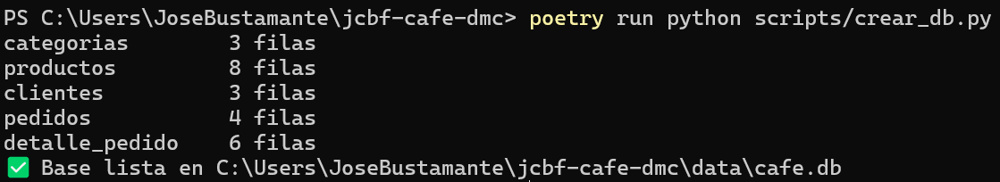
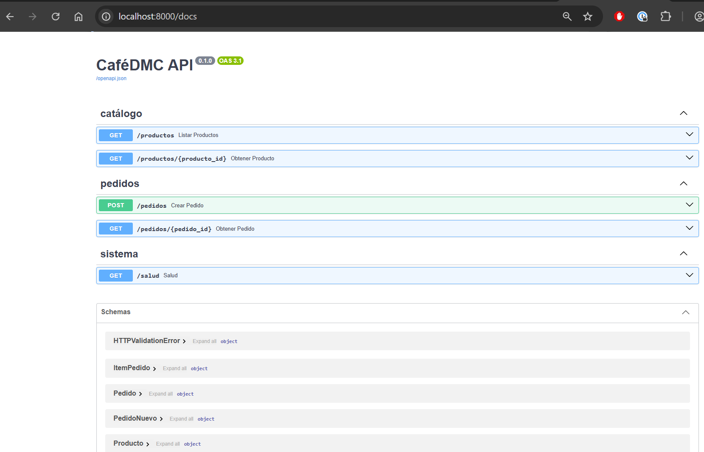
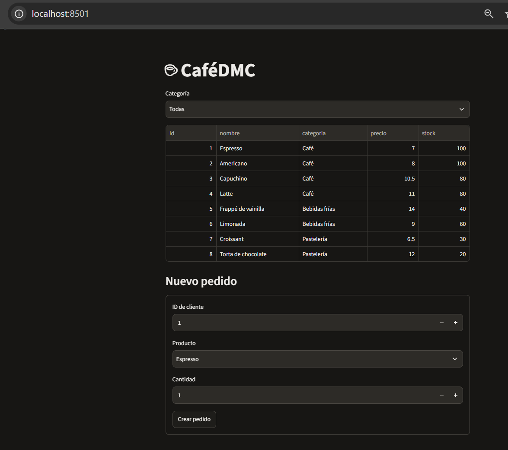

# Bitácora de evidencias · Jose Bustamante

## Sesión 1 · 2026-11-16 (completada el 2026-11-22)

### Evidencias del taller
> Capturas tomadas el 2026-11-22 y guardadas en `docs/img/`. Junto a cada una va la salida
> en texto del comando.

**Versión de Python y ruta del entorno**

```text
> poetry --version
Poetry (version 2.5.1)
> poetry run python --version
Python 3.15.2
> poetry env info --path
C:\Users\JoseBustamante\jcbf-cafe-dmc\.venv
```

**El agente responde el comando de pruebas**

Pregunta (2026-11-22): "¿Con qué comando exacto ejecuto las pruebas de este proyecto y dónde van
las reglas de negocio?". El agente respondió `poetry run pytest -q` citando `AGENTS.md` y
`CLAUDE.md`. Ubicó las reglas de negocio en `servicio.py` de cada módulo, según ADR-0002 y
`arquitectura.md`. También advirtió que `AGENTS.md` aún no dice dónde van las reglas de negocio:
falta agregar la regla de dependencias entre módulos que pide ADR-0002. Corregido el mismo día:
`AGENTS.md` §3 ahora dice dónde van las reglas de negocio y cómo se usan los módulos entre sí.

**Diagrama de contenedores renderizado**

`docs/arquitectura.md` tiene los niveles C4 1 (contexto) y 2 (contenedores) y, por el
ejercicio 1.4, el nivel 3 (componentes de la API).

**Historial de commits** (`git log --oneline`)

```text
030a414 S1: proyecto Poetry, AGENTS.md, ADR-0001 y diagramas C4
4ee4648 S1: proyecto Poetry, AGENTS.md, ADR-0001 y diagramas C4
```

### Errores que tuve y cómo los resolví
- **`poetry: command not found` en la terminal del agente.** Poetry se instaló en
  `%APPDATA%\pypoetry\venv\Scripts\poetry.exe`, pero esa carpeta no estaba en el PATH de la
  terminal que usa el agente. Se resolvió llamando a Poetry por su ruta completa. Pendiente:
  agregar `%APPDATA%\Python\Scripts` al PATH del usuario (paso 1 del taller).
- **`poetry run pytest -q` termina con código 5.** No es un fallo de prueba: pytest devuelve 5
  cuando no encuentra pruebas (`no tests ran`). `tests/` todavía está vacío; se resuelve en la
  sesión 2, al escribir las primeras pruebas de la API.

### Qué corregí de lo que propuso el agente
- **Glosario de `AGENTS.md` (ejercicio 1.1):** corregí el glosario que propuso el agente antes
  de dejarlo en el repositorio. La versión final define pedido, ítem, stock, cliente y estado
  del pedido, con los estados `pendiente`, `pagado`, `entregado` y `anulado` y el flujo entre ellos.

### Ejercicio 1.1 · Glosario en AGENTS.md
Hecho: sección **Glosario** en `AGENTS.md` con pedido, ítem, stock, cliente y estado del pedido
(`pendiente`, `pagado`, `entregado`, `anulado`) y el flujo entre estados.

### Ejercicio 1.2 · Preguntas sobre el entorno (Poetry 2.5.1)
**a) ¿Qué versión de pytest quedó instalada?**
pytest **9.2.0** (`poetry show pytest`).

**b) ¿De qué paquetes depende ruff?**
De ninguno. `poetry show ruff` (0.17.5) no lista dependencias, porque ruff está escrito en Rust
y se instala como un binario listo para usar. pytest, en cambio, depende de colorama, iniconfig,
packaging, pluggy y pygments.

**c) ¿En qué ruta está el entorno?**
`C:\Users\JoseBustamante\jcbf-cafe-dmc\.venv` (`poetry env info --path`). Está dentro del
proyecto porque `virtualenvs.in-project = true`.

**d) ¿Qué pasa si borro `.venv` y ejecuto `poetry install`?**
Poetry crea un `.venv` nuevo e instala exactamente las mismas versiones que fija `poetry.lock`.
`pyproject.toml` y `poetry.lock` no cambian, así que el entorno queda igual que antes.
`.venv` se puede volver a crear en cualquier momento y no se sube al repositorio; lo que se
versiona es el lock. (Respuesta razonada; no borré el `.venv` para comprobarlo).

### Ejercicio 1.3 · ADR-0002
Hecho: `docs/adr/0002-estilo-arquitectura.md`. CaféDMC empieza como **monolito modular**
(módulos `catalogo` y `pedidos` en un solo proceso FastAPI), con condiciones de revisión
y un camino para separar servicios de a uno.

### Ejercicio 1.4 · Diagrama C4 de componentes
Hecho: sección 3 de `docs/arquitectura.md` (router, schemas, servicio y repositorio por módulo,
más `main.py` y `db.py`). Es el diseño objetivo; `app/` aún no tiene código.

### Ejercicio 1.5 · Problemas del AGENTS.md defectuoso
1. **Secreto en el archivo**: la API key `sk-proj-…` queda en el repositorio y en el historial
   de git. Hay que revocarla y moverla a `.env` (ignorado por git).
2. **Comando de pruebas ambiguo**: "pytest o python -m unittest, lo que funcione". Debe haber
   un solo comando: `poetry run pytest -q`.
3. **Rompe la reproducibilidad**: "instala con pip install" se salta `poetry.lock`. Debe ser
   `poetry add` (o `poetry add --group dev`).
4. **Descripción vacía**: "Es un sistema" no dice qué hace ni con qué stack.
5. **Reglas vagas**: "buenas prácticas" y "el estilo del equipo" no se pueden verificar. Deben
   ser reglas concretas: `poetry run ruff check .`, SQL parametrizado, cada endpoint con prueba.
6. **Falta el mapa**: no dice dónde está cada cosa (`app/`, `tests/`, `db/`, `docs/adr/`).

Versión corregida: el `AGENTS.md` actual del repositorio.

### Ejercicio 1.6 · pre-commit con ruff
- `pre-commit` en el grupo dev, `.pre-commit-config.yaml` con el hook `ruff-check`
  (`ruff-pre-commit` v0.17.5, igual que `poetry.lock`) e instalado con `poetry run pre-commit install`.
- Regla agregada a `AGENTS.md`: no usar `git commit --no-verify` y mantener el `rev` alineado con el lock.
- Prueba con un archivo temporal que tenía un import sin usar (luego se borró):
```text
> poetry run pre-commit run --files app/_prueba_hook.py
ruff check...............................................................Failed
F401 [*] `os` imported but unused
Found 1 error.
```

## Modelo de datos · 2026-11-22

### Esquema propuesto por el agente vs. esquema del curso
El agente propuso un esquema a partir de las cuatro historias de usuario. Quedó en el commit
`faf83cd` (`git show faf83cd:db/schema.sql`). Después lo reemplacé en `db/schema.sql` por el
esquema del curso. Las dos versiones tienen las mismas 5 entidades, las mismas claves foráneas,
los mismos estados del pedido y el borrado en cascada de los ítems. Difieren en lo siguiente:

**Nombres y estructura**
| Aspecto | Agente (`faf83cd`) | Curso | Comentario |
|---|---|---|---|
| Nombres de tabla | Singular: `categoria`, `producto`, `cliente`, `pedido`, `pedido_item` | Plural: `categorias`, `productos`, `clientes`, `pedidos`, `detalle_pedido` | Es solo convención; el código debe usar los del curso. |
| Clave primaria | `INTEGER PRIMARY KEY` | `INTEGER PRIMARY KEY AUTOINCREMENT` | `AUTOINCREMENT` nunca reutiliza el id de una fila borrada, a cambio de un poco más de trabajo para SQLite. |
| Clave de los ítems | Compuesta `(pedido_id, producto_id)` | `id` propio, sin `UNIQUE` | En el curso, un producto puede repetirse en el mismo pedido. |
| Tablas `STRICT` | Sí | No | Sin `STRICT`, SQLite guarda un texto en una columna numérica. |
| Fecha del pedido | `creado_en`, ISO-8601 UTC (`2026-11-23T02:46:46Z`) | `fecha`, `datetime('now')` (`2026-11-23 02:46:46`) | Ambas son UTC; la del curso no lo indica en el texto. |

**Dinero y total**
| Aspecto | Agente | Curso | Comentario |
|---|---|---|---|
| Tipo del dinero | `INTEGER` en céntimos | `REAL` | Con `REAL`, `0.1 + 0.2` da `0.30000000000000004`. |
| Total del pedido | No se guarda; se calcula sumando los ítems | `pedidos.total REAL NOT NULL DEFAULT 0` | El curso lo lee más rápido, pero el servicio debe mantenerlo sincronizado con los ítems: si un pedido se crea sin calcularlo, queda en 0. |
| Precio unitario | `CHECK (> 0)` | Sin `CHECK` | El curso acepta un precio unitario negativo. |

**Restricciones**
| Aspecto | Agente | Curso | Comentario |
|---|---|---|---|
| Email del cliente | Opcional, `UNIQUE COLLATE NOCASE` | `NOT NULL UNIQUE`, distingue mayúsculas | En el curso el email es obligatorio, pero `a@x.pe` y `A@X.PE` cuentan como dos clientes distintos. |
| Nombres repetidos | `COLLATE NOCASE` en categoría y producto | Distingue mayúsculas | En el curso pueden convivir "Bebidas" y "bebidas". |
| Nombres vacíos | `CHECK (length(trim(...)) > 0)` | Sin `CHECK` | El curso acepta `''` como nombre. |
| Borrado de padres | `ON DELETE RESTRICT` explícito | Por defecto (`NO ACTION`) | En la práctica se comportan igual con `foreign_keys = ON`. |

**Índices**
| Agente | Curso | Comentario |
|---|---|---|
| `producto(categoria_id, nombre)` | `productos(categoria_id)` | El del agente además devuelve los productos ordenados por nombre. |
| `pedido(cliente_id, creado_en)` | `pedidos(cliente_id)` | El del agente además ordena el historial del cliente por fecha. |
| `pedido(estado, creado_en)` | — | El curso no tiene índice por estado (lista del cajero, ventas pagadas o entregadas). |
| `pedido_item(producto_id)` | — | El curso no indexa por producto, que es lo que necesita el reporte de más vendidos. |
| Cubierto por la clave compuesta | `detalle_pedido(pedido_id)` | Es el mismo acceso, ítems de un pedido, resuelto de dos formas. |

**Comprobación del esquema del curso.** Lo cargué en una base en memoria. Aceptó, sin dar error:
- el mismo producto dos veces en un pedido;
- un `precio_unitario` de `-5`;
- el email `A@X.PE` cuando ya existía `a@x.pe`;
- `precio = 'abc'`. El `CHECK (precio > 0)` no lo detiene porque en SQLite cualquier texto
  se considera mayor que cualquier número.

**Qué implica para el código.** El esquema del curso deja varias reglas al servicio:
- `pedidos/servicio.py` debe juntar los productos repetidos en una sola línea, rechazar precios
  y cantidades inválidos y recalcular `total` en la misma transacción que crea o modifica el pedido.
- Conviene manejar el dinero con `Decimal` en Python y redondear a 2 decimales antes de guardarlo.

### Creación de la base con el esquema del curso
`scripts/crear_db.py` crea `data/cafe.db` a partir de `db/schema.sql` y la llena con datos de
prueba. Si la base ya existe, no la vuelve a llenar; con `--reset` la borra y la crea de nuevo.
`data/*.db` está en `.gitignore`, así que la base no se sube al repositorio.


```text
> poetry run python scripts/crear_db.py
categorias        3 filas
productos         8 filas
clientes          3 filas
pedidos           4 filas
detalle_pedido    6 filas
✅ Base lista en C:\Users\JoseBustamante\jcbf-cafe-dmc\data\cafe.db
```
Los conteos coinciden con los datos del script:
- 3 categorías: Café, Bebidas frías y Pastelería.
- 8 productos.
- 3 clientes.
- 4 pedidos: 2 `entregado`, 1 `pagado` y 1 `pendiente`.
- 6 ítems entre los cuatro pedidos.

El script calcula y guarda el `total` de cada pedido al insertarlo, porque el esquema del curso
lo deja en 0 si nadie lo calcula.

### Levantar la API
`app/main.py` crea la aplicación FastAPI (`CaféDMC API`, versión 0.1.0) y registra los routers de
`catalogo` y `pedidos`. Se levanta con el servidor `uvicorn`, que viene incluido en
`fastapi[standard]`:
```text
> poetry run uvicorn app.main:app --reload
INFO:     Uvicorn running on http://127.0.0.1:8000 (Press CTRL+C to quit)
```
La documentación interactiva (Swagger) queda en `http://localhost:8000/docs`, y el contrato
OpenAPI 3.1 en `/openapi.json`.



| Grupo | Método y ruta | Operación |
|---|---|---|
| catálogo | `GET /productos` | Listar productos |
| catálogo | `GET /productos/{producto_id}` | Obtener un producto |
| pedidos | `POST /pedidos` | Crear un pedido |
| pedidos | `GET /pedidos/{pedido_id}` | Obtener un pedido |
| sistema | `GET /salud` | Comprobar que la API responde |

Esquemas: `ItemPedido`, `Pedido`, `PedidoNuevo`, `Producto` y `HTTPValidationError`.

Comprobación (2026-11-22): levanté la API en otro puerto y verifiqué que respondiera.
- `GET /salud` respondió `200 {"estado":"ok"}`.
- `GET /docs` respondió `200`.
- `/openapi.json` listó las 5 operaciones de la tabla.

### Pruebas de la API
`tests/test_api.py` prueba la API con el `TestClient` de FastAPI. Cada prueba crea una base
temporal con `crear_db.crear()` y la apunta mediante la variable `CAFE_DB`, así que nunca toca
`data/cafe.db`.


```text
> poetry run pytest -q
.......
7 passed in 2.48s
```

| Prueba | Endpoint | Qué comprueba |
|---|---|---|
| `test_salud` | `GET /salud` | Responde `{"estado": "ok"}`. |
| `test_listar_productos` | `GET /productos` | Devuelve los 8 productos de prueba. |
| `test_filtrar_por_categoria` | `GET /productos?categoria=` | "Pastelería" devuelve solo Croissant y Torta de chocolate. |
| `test_producto_inexistente` | `GET /productos/{id}` | Un id que no existe devuelve 404. |
| `test_crear_pedido_calcula_total` | `POST /pedidos` | Responde 201 y calcula el total: 2 × 7.0 + 1 × 6.5 = 20.5. |
| `test_stock_insuficiente` | `POST /pedidos` | Hay 20 tortas: el primer pedido de 15 se acepta y el segundo de 15 se rechaza con 409. |
| `test_cantidad_maxima` | `POST /pedidos` | Una cantidad de 21 se rechaza con 422. |

Con esto ya no ocurre el código 5 anotado en la sesión 1 (pytest sin pruebas).

**Pendiente:** `GET /pedidos/{pedido_id}` todavía no tiene prueba, y AGENTS.md pide al menos
una por endpoint.

### Pantalla Streamlit
`ui/streamlit_app.py` es la pantalla de CaféDMC. Solo llama a la API por HTTP con `httpx`,
como pide AGENTS.md: no importa código de `app/` ni abre la base. La dirección de la API se
toma de la variable `CAFE_API` (por defecto `http://127.0.0.1:8000`). Primero se levanta la
API y después la pantalla:
```text
> poetry run uvicorn app.main:app --reload
> poetry run streamlit run ui/streamlit_app.py
  Local URL: http://localhost:8501
```



Qué muestra la pantalla:
- **Catálogo:** la tabla con los 8 productos (id, nombre, categoría, precio y stock), que vienen
  de `GET /productos`. El selector "Categoría" filtra por "Todas" o por una categoría; el filtro
  se aplica en la pantalla, sin volver a llamar a la API.
- **Nuevo pedido:** un formulario con ID de cliente, producto y cantidad (de 1 a 20). Al pulsar
  "Crear pedido" llama a `POST /pedidos`. Si sale bien, muestra el número de pedido y el total
  en soles; si falla, el código y el mensaje de error que devuelve la API (por ejemplo, 409 por
  falta de stock).
- Si la API no responde, la pantalla muestra un aviso y no carga nada más.

**Diferencias con las historias de usuario y con AGENTS.md:**
- El formulario permite un solo producto por pedido. La historia pide un pedido con varios
  productos y cantidades; la API ya los acepta, pero la pantalla no.
- El cliente se elige escribiendo su número de ID, sin mostrar su nombre.
- La pantalla está en `ui/`, pero AGENTS.md §3 dice que la pantalla va en `app/`. Hay que mover
  el archivo o corregir AGENTS.md.

### Crear un pedido y descontar stock desde la pantalla
Desde el formulario "Nuevo pedido" creé un pedido para el cliente 1 con 1 Espresso:


- La API respondió **"Pedido #8 creado. Total: S/ 7.00"**. El total es correcto: 1 × 7.00.
- El stock de Espresso aparece en **97**; antes de usar la pantalla era 100 (ver la captura
  anterior). Los otros 7 productos no cambiaron.
- Es el pedido #8 porque los datos de prueba traen 4 pedidos (#1 a #4) y antes de esta captura
  ya había creado otros desde la pantalla.

Cómo lo hace la API (`app/pedidos.py`, `POST /pedidos`):
1. Comprueba que el cliente exista y que cada producto exista, esté activo y tenga stock
   suficiente. Si falta stock, responde 409.
2. Calcula el total con el precio actual de cada producto.
3. En una sola transacción inserta el pedido en estado `pendiente`, inserta sus líneas en
   `detalle_pedido` y descuenta el stock con `UPDATE productos SET stock = stock - ? WHERE id = ?`.

**Observaciones:**
- **La tabla puede mostrar el stock de antes del pedido.** Streamlit vuelve a ejecutar el script
  de arriba abajo al enviar el formulario, y lee los productos antes de llamar a
  `POST /pedidos`. Para ver el stock que dejó este pedido hay que recargar la página.
- **Riesgo de carrera.** El stock se revisa antes de abrir la transacción, y el `UPDATE` no
  vuelve a comprobarlo. Si dos pedidos llegan al mismo tiempo, el segundo choca con el
  `CHECK (stock >= 0)` y termina en un error 500 en lugar de un 409. Para evitarlo, el `UPDATE`
  debe incluir `AND stock >= ?` y rechazar el pedido si no actualiza ninguna fila.
- **Los datos de prueba no descuentan stock.** `crear_db.py` inserta los pedidos #1 a #4 sin
  restarlos del stock; por eso la primera captura mostraba el stock completo.

### Revisión de `app/pedidos.py` y `app/catalogo.py` contra AGENTS.md
Le pedí al agente revisar los dos módulos y listar como máximo 5 riesgos (seguridad,
concurrencia y datos), ordenados por gravedad, sin cambiar código. Incluyó `app/modelos.py`
porque ahí están las validaciones de entrada. Los números de línea corresponden al commit `68aa995`.

| # | Tipo | Riesgo | Dónde |
|---|---|---|---|
| 1 | Concurrencia | El stock se revisa **antes** de abrir la transacción y el `UPDATE … SET stock = stock - ?` no lo vuelve a comprobar. Si llegan dos pedidos a la vez, ambos pasan; el segundo choca con `CHECK (stock >= 0)`, el `IntegrityError` no se captura y la API responde **500** en lugar de 409. Si una migración quitara el `CHECK`, el stock quedaría negativo sin que nadie lo note. | `pedidos.py:17-24`, `pedidos.py:35` |
| 2 | Datos | **Producto repetido en un pedido.** Cada línea se compara contra el stock completo. Un solo pedido con dos líneas de 15 tortas, con stock 20, pasa la revisión, intenta descontar 30 y termina en 500. Se reproduce siempre, con una sola petición. Ni `PedidoNuevo` ni `detalle_pedido` impiden repetir un producto. | `pedidos.py:16-26`, `modelos.py:20` |
| 3 | Seguridad | **No hay autenticación.** `POST /pedidos` acepta cualquier `cliente_id` y descuenta stock en su nombre. `GET /pedidos/{id}` devuelve el pedido de cualquiera, y los id son consecutivos. Cualquiera puede vaciar el stock con pedidos `pendiente` que nunca se pagan. | `pedidos.py:12`, `pedidos.py:40-43` |
| 4 | Arquitectura y datos | **Pedidos hace SQL sobre `productos`**, una tabla de Catálogo: la lee y le descuenta stock. AGENTS.md §3 pide que lo haga a través de `catalogo/servicio.py`. Tampoco existen las capas `router` / `servicio` / `repositorio`: las reglas de negocio están en el router. Cualquier regla que Catálogo agregue sobre el stock se salta. | `pedidos.py:12-35` |
| 5 | Datos | **El dinero se maneja como `float`.** El total se acumula en `float` (`0.1 * 3 = 0.30000000000000004`) y se redondea al final. `total` se guarda en la tabla y nada lo vuelve a calcular desde `detalle_pedido`, así que puede quedar desalineado con sus líneas. | `pedidos.py:14`, `pedidos.py:25`, `pedidos.py:29`, `modelos.py:9`, `modelos.py:27` |

**Qué cumple:** todo el SQL va parametrizado con `?`. En `catalogo.py:19` y `catalogo.py:27`,
`SQL_BASE +` solo concatena texto fijo: el valor de la categoría y el id van como parámetros.
`catalogo.py` solo toca sus propias tablas.

**Fuera del límite de 5:** `GET /pedidos/{pedido_id}` no tiene prueba, y AGENTS.md pide al
menos una por endpoint.

**Cómo corregirlos (pendiente, no se cambió código):**
- **1 y 2:** juntar los productos repetidos en una sola línea antes de validar. Dentro de la
  transacción, descontar con `UPDATE … SET stock = stock - ? WHERE id = ? AND stock >= ?` y
  responder 409 si no se actualizó ninguna fila.
- **4:** separar `app/catalogo/` y `app/pedidos/` en `router.py`, `schemas.py`, `servicio.py` y
  `repositorio.py`, y que el descuento de stock pase por `catalogo/servicio.py`.
- **5:** usar `Decimal` (o céntimos enteros) para calcular el total.
- **3:** se resuelve con autenticación, que está fuera del alcance actual.
