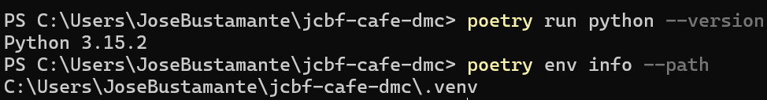
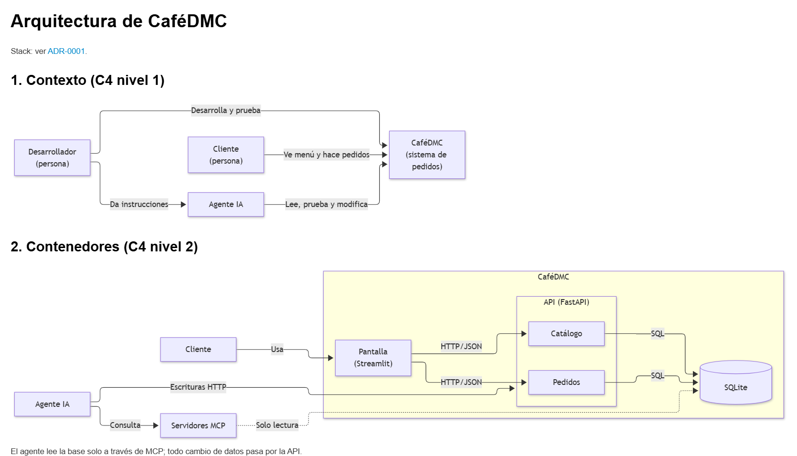
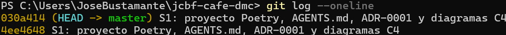

# Bitácora de evidencias · Jose Bustamante

## Sesión 1 · 2026-11-16 (completada el 2026-11-22)

### Evidencias del taller
> Capturas tomadas el 2026-11-22 y guardadas en `docs/img/`. Junto a cada una va la salida
> en texto del comando.

**Versión de Python y ruta del entorno**

```text
> poetry --version
Poetry (version 2.5.1)
> poetry run python --version
Python 3.15.2
> poetry env info --path
C:\Users\JoseBustamante\jcbf-cafe-dmc\.venv
```

**El agente responde el comando de pruebas**

Pregunta (2026-11-22): "¿Con qué comando exacto ejecuto las pruebas de este proyecto y dónde van
las reglas de negocio?". El agente respondió `poetry run pytest -q` citando `AGENTS.md` y
`CLAUDE.md`. Ubicó las reglas de negocio en `servicio.py` de cada módulo, según ADR-0002 y
`arquitectura.md`. También advirtió que `AGENTS.md` aún no dice dónde van las reglas de negocio:
falta agregar la regla de dependencias entre módulos que pide ADR-0002. Corregido el mismo día:
`AGENTS.md` §3 ahora dice dónde van las reglas de negocio y cómo se usan los módulos entre sí.

**Diagrama de contenedores renderizado**

`docs/arquitectura.md` tiene los niveles C4 1 (contexto) y 2 (contenedores) y, por el
ejercicio 1.4, el nivel 3 (componentes de la API).

**Historial de commits** (`git log --oneline`)

```text
030a414 S1: proyecto Poetry, AGENTS.md, ADR-0001 y diagramas C4
4ee4648 S1: proyecto Poetry, AGENTS.md, ADR-0001 y diagramas C4
```

### Errores que tuve y cómo los resolví
- **`poetry: command not found` en la terminal del agente.** Poetry se instaló en
  `%APPDATA%\pypoetry\venv\Scripts\poetry.exe`, pero esa carpeta no estaba en el PATH de la
  terminal que usa el agente. Se resolvió llamando a Poetry por su ruta completa. Pendiente:
  agregar `%APPDATA%\Python\Scripts` al PATH del usuario (paso 1 del taller).
- **`poetry run pytest -q` termina con código 5.** No es un fallo de prueba: pytest devuelve 5
  cuando no encuentra pruebas (`no tests ran`). `tests/` todavía está vacío; se resuelve en la
  sesión 2, al escribir las primeras pruebas de la API.

### Qué corregí de lo que propuso el agente
- _(Completar: qué cambiaste tú en AGENTS.md, ADR-0001 o los diagramas que propuso el agente.)_

### Ejercicio 1.1 · Glosario en AGENTS.md
Hecho: sección **Glosario** en `AGENTS.md` con pedido, ítem, stock, cliente y estado del pedido
(`pendiente`, `pagado`, `entregado`, `anulado`) y el flujo entre estados.

### Ejercicio 1.2 · Preguntas sobre el entorno (Poetry 2.5.1)
**a) ¿Qué versión de pytest quedó instalada?**
pytest **9.2.0** (`poetry show pytest`).

**b) ¿De qué paquetes depende ruff?**
De ninguno. `poetry show ruff` (0.17.5) no lista dependencias, porque ruff está escrito en Rust
y se instala como un binario listo para usar. pytest, en cambio, depende de colorama, iniconfig,
packaging, pluggy y pygments.

**c) ¿En qué ruta está el entorno?**
`C:\Users\JoseBustamante\jcbf-cafe-dmc\.venv` (`poetry env info --path`). Está dentro del
proyecto porque `virtualenvs.in-project = true`.

**d) ¿Qué pasa si borro `.venv` y ejecuto `poetry install`?**
Poetry crea un `.venv` nuevo e instala exactamente las mismas versiones que fija `poetry.lock`.
`pyproject.toml` y `poetry.lock` no cambian, así que el entorno queda igual que antes.
`.venv` se puede volver a crear en cualquier momento y no se sube al repositorio; lo que se
versiona es el lock. (Respuesta razonada; no borré el `.venv` para comprobarlo).

### Ejercicio 1.3 · ADR-0002
Hecho: `docs/adr/0002-estilo-arquitectura.md`. CaféDMC empieza como **monolito modular**
(módulos `catalogo` y `pedidos` en un solo proceso FastAPI), con condiciones de revisión
y un camino para separar servicios de a uno.

### Ejercicio 1.4 · Diagrama C4 de componentes
Hecho: sección 3 de `docs/arquitectura.md` (router, schemas, servicio y repositorio por módulo,
más `main.py` y `db.py`). Es el diseño objetivo; `app/` aún no tiene código.

### Ejercicio 1.5 · Problemas del AGENTS.md defectuoso
1. **Secreto en el archivo**: la API key `sk-proj-…` queda en el repositorio y en el historial
   de git. Hay que revocarla y moverla a `.env` (ignorado por git).
2. **Comando de pruebas ambiguo**: "pytest o python -m unittest, lo que funcione". Debe haber
   un solo comando: `poetry run pytest -q`.
3. **Rompe la reproducibilidad**: "instala con pip install" se salta `poetry.lock`. Debe ser
   `poetry add` (o `poetry add --group dev`).
4. **Descripción vacía**: "Es un sistema" no dice qué hace ni con qué stack.
5. **Reglas vagas**: "buenas prácticas" y "el estilo del equipo" no se pueden verificar. Deben
   ser reglas concretas: `poetry run ruff check .`, SQL parametrizado, cada endpoint con prueba.
6. **Falta el mapa**: no dice dónde está cada cosa (`app/`, `tests/`, `db/`, `docs/adr/`).

Versión corregida: el `AGENTS.md` actual del repositorio.

### Ejercicio 1.6 · pre-commit con ruff
- `pre-commit` en el grupo dev, `.pre-commit-config.yaml` con el hook `ruff-check`
  (`ruff-pre-commit` v0.17.5, igual que `poetry.lock`) e instalado con `poetry run pre-commit install`.
- Regla agregada a `AGENTS.md`: no usar `git commit --no-verify` y mantener el `rev` alineado con el lock.
- Prueba con un archivo temporal que tenía un import sin usar (luego se borró):
```text
> poetry run pre-commit run --files app/_prueba_hook.py
ruff check...............................................................Failed
F401 [*] `os` imported but unused
Found 1 error.
```
